# 📚 EPUB Translator Google

🌐 [Português (BR)](README.md) | **English** | [Español](README.es.md) | [简体中文](README.zh-CN.md)

[](https://www.rust-lang.org/)
[](https://tokio.rs/)
[](#-software-architecture)
[](https://www.sqlite.org/)
[](#-automated-tests)
[](https://crates.io/crates/clap)
[](LICENSE)

> High-performance professional EPUB e-book translator written in Rust (Edition 2024). Designed under strict **Ports & Adapters (Hexagonal)** architecture and **Clean Code** principles, it offers dual execution modes (interactive TUI with visual arrow-key navigation and strict Headless/Batch mode for CI/CD and automation), configurable parallel concurrency across chapters and blocks, a resilient engine with an **XHTML Syntactic Auto-Healer**, persistent **SQLite WAL cache with ZSTD compression**, and three translation engines: **Google Antigravity (Gemini)**, **Google Free (gtx)**, and **Google Cloud Translation API**.

---

## 📑 Table of Contents

- [Overview & Highlights](#-overview--highlights)
- [Key Features](#-key-features)
- [Supported Translation Providers](#-supported-translation-providers)
- [Installation & Uninstallation](#-installation--uninstallation)
  - [Quick System Installation (`~/.local/bin`)](#quick-system-installation-localbin)
  - [Manual Build via Cargo](#manual-build-via-cargo)
  - [Uninstallation](#uninstallation)
- [Usage Guide & Subcommands](#-usage-guide--subcommands)
  - [1. Interactive Mode (TUI)](#1-interactive-mode-tui)
  - [2. Headless / Batch Mode (for Scripts and CI/CD)](#2-headless--batch-mode-for-scripts-and-cicd)
  - [3. `verify` Subcommand: Strict OCF & XML 1.0 Validation](#3-verify-subcommand-strict-ocf--xml-10-validation)
  - [4. `history` Subcommand: Telemetry & Execution Metrics](#4-history-subcommand-telemetry--execution-metrics)
  - [Complete CLI Options Reference](#complete-cli-options-reference)
- [Resilience Engine & Auto-Healer](#-resilience-engine--auto-healer)
  - [XhtmlValidator & Two-Pass Syntactic Auto-Healer](#xhtmlvalidator--two-pass-syntactic-auto-healer)
  - [Adaptive Partitioning for Giant Chapters (>100KB)](#adaptive-partitioning-for-giant-chapters-100kb)
  - [Exponential Backoff with Anti-Throttling Jitter](#exponential-backoff-with-anti-throttling-jitter)
- [SQLite WAL Cache with ZSTD Compression](#-sqlite-wal-cache-with-zstd-compression)
- [Software Architecture](#-software-architecture)
  - [Hexagonal Diagram (Ports & Adapters)](#architecture-diagram)
  - [Engineering Invariants & Rigor](#engineering-invariants--rigor)
- [Strict EPUB Format Preservation (IDPF OCF)](#-strict-epub-format-preservation-idpf-ocf)
- [Project Structure](#-project-structure)
- [Automated Tests](#-automated-tests)
- [License & Policies](#-license--policies)

---

## 🌟 Overview & Highlights

Translating digital books while preserving typographic formatting, dynamic tables of contents, CSS stylesheets, illustrations, and XML compliance is one of the most complex challenges in the publishing ecosystem. `epub-translator-google` solves this end-to-end:

1. **Asynchronous Parallelism with Tokio:** Controlled concurrency across chapters (`-c, --concurrency`) and internal parallel block processing for extensive chapters (`--block-concurrency`).
2. **Flexible Dual Interface:** Choose between the guided terminal wizard (keyboard selection with dynamic search) or strict headless mode for bash scripts, CI/CD pipelines, and batch automation.
3. **Industrial Resilience with Auto-Healer:** `XhtmlValidator` syntactic engine capable of healing broken quotes and balancing tags generated by LLMs, preventing translation glitches from corrupting the final file.
4. **SQLite WAL Cache with ZSTD Compression (Level 3):** Drastic disk space reduction of up to 70%, with cryptographic hashes per block/chapter ensuring idempotency and immediate resumption of interrupted runs.
5. **Native Auditing and Verification:** `verify` subcommand for strict OCF/XML checking (Google Play Books and EpubCheck standard) and `history` for tracking telemetry and latencies.

---

## 🚀 Key Features

- **Guided Interactive TUI (`inquire`):** Smooth navigation with `↑` / `↓` arrow keys, real-time language filtering, and dynamic model and provider selection.
- **Reactive Progress Bar (`indicatif`):** Completion percentage, chapter counter, throughput rate, and accurate time-to-completion estimate (ETA).
- **Integrated `verify` Subcommand:** Structural OCF compliance validation (20-byte uncompressed `mimetype`), `container.xml` parsing, `.opf` package integrity, and XML 1.0 syntax checking across 100% of XHTML documents.
- **`history` Subcommand with Multi-Format Export:** Tabular, JSON, or CSV viewing and exporting of historical execution metrics (hit ratio, latency, and duration).
- **Strict Headless Mode (`--headless`):** Fails immediately with a non-zero exit code and descriptive messages if required arguments are missing, without hanging automated pipelines.
- **Two-Dimensional Concurrency:** Asynchronous parallel concurrency across independent chapters and internal block-level parallelism for large chapters.
- **Two-Pass Syntactic Auto-Healer:** Automatic recovery from unbalanced XML tags, unescaped ampersands, and missing or typographic quotes.
- **Adaptive Partitioning for Giant Chapters:** Smart segmentation of chapters exceeding 100 KB while preserving header/footer skeletons and performing concurrent block translation.
- **Smart Retries:** Exponential backoff with jitter to handle 500, 502, 503, 504, 429 errors, or temporary network timeouts.
- **Compact Local Cache:** SQLite WAL database with ZSTD level 3 compression and a native routine to automatically purge empty or corrupted entries.

---

## 🌐 Supported Translation Providers

| Provider | CLI Identifiers | Access Type | Technical Highlight |
| :--- | :--- | :--- | :--- |
| **Google Antigravity (Gemini)** | `antigravity`, `agy`, `gemini` | Local CLI (`agy`) | AI-powered neural literary translation, model selection (`--model`), style preservation, adaptive partitioning, and auto-healer. |
| **Google Free Endpoint** | `google-free`, `free`, `gtx` | Anonymous / Web | Free and requires no credentials. `⟦n⟧` tag-masking algorithm, rate-controlled Tokio async semaphore, and anti-throttling jitter. |
| **Google Cloud Translation** | `google-cloud`, `cloud`, `gcp` | API Key (`--api-key`) | Official Google Cloud v2 API. Native HTML format support (`format="html"`), high stability, and enterprise quotas. |

---

## 📦 Installation & Uninstallation

### Quick System Installation (`~/.local/bin`)

The repository provides an automation script that builds in release mode with maximum optimizations and deploys the binary directly to the user directory:

```bash
git clone https://github.com/passella/epub-translator-google.git
cd epub-translator-google
chmod +x install.sh uninstall.sh
./install.sh
```

The installer checks whether `~/.local/bin` is present in the `$PATH` environment variable and provides clear export instructions if needed.

### Manual Build via Cargo

To build manually using the official Rust toolchain:

```bash
cargo build --release
```

The optimized executable will be available at:

```bash
./target/release/epub-translator-google --help
```

### Uninstallation

To completely remove the executable from the system:

```bash
./uninstall.sh
```

Or using the installer's built-in flag:

```bash
./install.sh --uninstall
```

---

## 📖 Usage Guide & Subcommands

### 1. Interactive Mode (TUI)

Start the guided wizard by passing the EPUB file as an argument or invoke the command with no parameters:

```bash
epub-translator-google book.epub
```

The wizard will guide you step by step:

1. **Input File:** Disk existence validation.
2. **Source Language:** Select automatic detection (`auto`), suggested languages (`en`, `es`, `fr`, `de`), or type any ISO code.
3. **Target Language:** Select `pt-BR` or enter another language code.
4. **Translation Provider:** Choose with `↑` / `↓` arrow keys between Google Antigravity, Google Free, or Google Cloud API.
5. **Model (when applicable):** When using Antigravity, choose from the models detected on the system.
6. **Output File:** The `<book>-<target>.epub` path is automatically generated and suggested.
7. **Execution:** Follow the progress bar showing the status of each translated chapter in real time.

```text
? Source language: 
  > auto (Auto-detect)
    en (English)
    es (Spanish)
    fr (French)
    de (German)
    Other...

? Translation provider:
  > Google Antigravity (agy / Gemini - Maximum Literary Fidelity)
    Google Free Endpoint (gtx - Free / No Keys)
    Google Cloud Translation API (Official / API Key)

[00:01:23] [========================================] 24/24 chapters (100%) - ETA: 00:00:00
```

---

### 2. Headless / Batch Mode (for Scripts and CI/CD)

By providing all options or the `--headless` flag, the tool operates completely autonomously without keyboard interaction:

#### Concurrent Translation with Antigravity (Gemini via agy):
```bash
epub-translator-google \
  --input "Clean_Code.epub" \
  --source "en" \
  --target "pt-BR" \
  --provider "antigravity" \
  --concurrency 4 \
  --block-concurrency 2 \
  --output "Clean_Code_ptBR.epub"
```

#### Strict Headless Mode with Google Free (gtx):
```bash
epub-translator-google \
  --headless \
  -i "The_Art_of_War.epub" \
  -s "auto" \
  -t "pt-BR" \
  -p "google-free" \
  -c 6 \
  -o "The_Art_of_War_ptBR.epub"
```

#### Enterprise Translation with Google Cloud Translation API:
```bash
epub-translator-google \
  --headless \
  -i "Technical_Manual.epub" \
  -t "es" \
  -p "google-cloud" \
  --api-key "YOUR_GCP_KEY_HERE" \
  -o "Technical_Manual_es.epub"
```

---

### 3. `verify` Subcommand: Strict OCF & XML 1.0 Validation

The `verify` subcommand performs a full integrity audit on the EPUB file, ensuring the book meets the standards required by strict platforms such as **Google Play Books**, **Apple Books**, and the official **EpubCheck** validator:

```bash
epub-translator-google verify translated_book.epub
```

#### What is validated:
- **OCF Mimetype:** ZIP header validation. The first file must be `mimetype`, uncompressed (`Stored`), with zero extra fields, and containing the exact 20 bytes `application/epub+zip`.
- **META-INF/container.xml:** Mandatory presence and strict XML 1.0 syntactic validation, ensuring the `.opf` package file is properly located.
- **Package Document (.opf):** Resolution of the declared root file and XML validation against unclosed tags or corrupted attributes.
- **XHTML/HTML Documents:** Exhaustive scan of all content files in the book, verifying that 100% of them are well-formed, with no bare ampersands and no null bytes.

Sample success output:
```text
EPUB verification successful: translated_book.epub
  - OCF Mimetype: Valid (Stored, 20 bytes)
  - container.xml: Valid
  - OPF Package: Valid
  - XHTML files: 42/42 valid (100% compliant)
```

---

### 4. `history` Subcommand: Telemetry & Execution Metrics

The `history` subcommand lets you audit the performance of previous translations, displaying cache hit ratios, average latencies, and total duration.

#### Default Table View:
```bash
epub-translator-google history --limit 5
```

```text
ID | Date/Time           | Provider    | Target  | Chapters  | Hits | Misses | Hit Ratio | Avg Latency    | Total Duration
---+---------------------+-------------+---------+-----------+------+--------+-----------+----------------+---------------
1  | 2026-11-10 14:22:01 | antigravity | pt-BR   | 32        | 12   | 20     | 37.5%     | 1420.5ms       | 28.45s
2  | 2026-11-10 15:05:12 | google-free | pt-BR   | 18        | 18   | 0      | 100.0%    | 12.3ms         | 0.42s
```

#### JSON Export (for integration with scripts and pipelines):
```bash
epub-translator-google history --format json --limit 10
```

#### CSV Export (for spreadsheets and reports):
```bash
epub-translator-google history --format csv > translation_history.csv
```

---

### Complete CLI Options Reference

```text
Usage: epub-translator-google [SUBCOMMAND] [OPTIONS] [EPUB_FILE_POS]

Subcommands:
  verify <EPUB_FILE>        Validates strict OCF and XML 1.0 compliance of the EPUB file
  history                   Displays and exports translation metrics history and telemetry
    -l, --limit <LIMIT>     Maximum number of records to display (default: 10)
    -f, --format <FORMAT>   Output format: table, json, or csv (default: table)

Positional Arguments:
  [EPUB_FILE_POS]           Alternative positional path for the input EPUB file

Global Translation Options:
  -i, --input <FILE>        Path to the input EPUB file to be translated
  -o, --output <OUTPUT>     Path to the translated destination EPUB file
  -s, --source <SOURCE>     Source language code (default: auto)
  -t, --target <TARGET>     Target language code (e.g., pt-BR, es, fr, de)
  -p, --provider <PROVIDER> Translation provider: antigravity, google-free, or google-cloud
      --model <MODEL>       Model name to be used by the Antigravity provider
      --headless            Runs in strict non-interactive mode (fails if options are missing)
  -c, --concurrency <N>     Parallel concurrency across chapters (default: 4)
      --block-concurrency <N> Internal block concurrency in giant chapters (default: 2)
      --db-cache <FILE>     Path to the SQLite cache database (default: translations_cache.db)
      --api-key <KEY>       Google Cloud Translation API key
  -h, --help                Displays detailed help information
  -V, --version             Displays the installed version of the program
```

---

## 🛡️ Resilience Engine & Auto-Healer

### XhtmlValidator & Two-Pass Syntactic Auto-Healer

During content translation via language models (LLMs), minor syntactic anomalies may be introduced in the output, such as omitted closing tags, typographic quotes (`“ ”`) replacing straight quotes in attributes, or bare ampersands (`&` instead of `&amp;`).

The `XhtmlValidator` engine employs a two-pass self-healing strategy prior to any final validation:
1. **Attribute and Entity Normalization:**
   - Detects and wraps unquoted attribute values.
   - Converts malformed quotes and standardizes XML syntax.
   - Replaces unescaped ampersand instances with `&amp;`, while preserving valid entities (`&lt;`, `&gt;`, `&#...;`).
2. **Tag Balancing and Hierarchical Stack:**
   - Traverses the XML syntax tree with `quick-xml`.
   - Automatically closes unclosed elements before the closing of their parent container.
   - Discards orphaned or unexpected closing tags, ensuring the resulting file is 100% compliant with strict XML 1.0 rules.

### Adaptive Partitioning for Giant Chapters (>100KB)

Large chapters (exceeding 100 KB) frequently exceed API output windows and cause timeouts. `XhtmlPartitioner` handles this transparently:
- **Structure Preservation:** Isolates the *prelude* (XML declaration, `<!DOCTYPE>`, `<head>` tags, and stylesheets) and the *postlude* (`</body></html>`).
- **Semantic Segmentation:** Splits content into coherent blocks (`<p>`, `<div>`, `<section>`) while respecting the 100 KB threshold.
- **Parallel Block Translation:** Blocks are translated concurrently according to the `--block-concurrency` flag.
- **Per-Block Cache (`blk:<hash>`):** Each block has its own cache key in SQLite. If the connection drops on block 8 of 10, resuming instantly reuses blocks 1 through 7 already stored in the database.

### Exponential Backoff with Anti-Throttling Jitter

Transient failures in remote APIs are handled automatically by the retry algorithm:
- **Transient Error Detection:** Maps failures such as `500 Internal Server Error`, `502/503/504`, `429 Too Many Requests`, `eligibility check failed`, timeouts, and TCP connection resets.
- **Weighted Delay:** $T = \min(InitialDelay \times Multiplier^{attempt}, MaxDelay) + Jitter$.
- Deterministic jitter prevents the *thundering herd* phenomenon, ensuring continuous resilience even under severe network fluctuations.

---

## 🗄️ SQLite WAL Cache with ZSTD Compression

To make translating dozens of books viable without saturating disk storage, the cache adapter uses **ZSTD (Zstandard)** compression:

```text
[Original Text] ---> [SHA-256 Hash / O(1) Hasher] ---> [ZSTD Level 3] ---> [SQLite BLOB]
```

- **Disk Savings:** The ZSTD (level 3) algorithm compresses text and XHTML markup with a **60% to 70%** reduction rate compared to plain text.
- **Transparent Compatibility:** The adapter validates the ZSTD header *magic number* (`0x28, 0xb5, 0x2f, 0xfd`). If it encounters legacy records stored in plain text, it decodes them normally and migrates them to the compressed format on subsequent writes.
- **Automatic Empty Entry Purge:** On database initialization, the `purge_corrupted_entries` method automatically cleans up any residual empty or corrupted records.
- **Safe Concurrency (WAL):** SQLite operates in `Write-Ahead Logging` mode (`PRAGMA journal_mode = WAL`), allowing non-blocking concurrent reads during parallel execution of multiple chapters.

---

## 🏗️ Software Architecture

The application strictly follows **Clean Architecture** and **Ports & Adapters (Hexagonal)** patterns, with strict separation between business domain and infrastructure/I/O adapters.

### Architecture Diagram

```mermaid
flowchart TD
    subgraph DrivingAdapters ["🔌 Driving Adapters (Input & CLI)"]
        CLI["Clap CLI Parser\n(args.rs / runner.rs)"]
        TUI["Interactive Inquire TUI\n(interactive.rs)"]
    end

    subgraph DomainCore ["💎 Pure Domain (Central Hexagon)"]
        UseCase["TranslateBookUseCase"]
        Partitioner["XhtmlPartitioner\n(>100KB Segmentation)"]
        Validator["XhtmlValidator\n(Auto-Healer & XML 1.0)"]
        Entities["Entities & Models\n(EpubBook, Chapter, Metrics)"]
        
        subgraph Ports ["⚓ Ports (Abstract Traits)"]
            EpubPort["EpubPort"]
            TranslatorPort["TranslatorPort"]
            CachePort["TranslationCachePort"]
            ProgressPort["ProgressReporterPort"]
        end
    end

    subgraph DrivenAdapters ["🔌 Driven Adapters (Output & Infrastructure)"]
        ZipAdapter["ZipEpubAdapter\n(quick-xml + zip OCF + Verify)"]
        AgyAdapter["AntigravityTranslatorAdapter\n(agy CLI + Gemini + Backoff)"]
        FreeAdapter["GoogleFreeTranslatorAdapter\n(gtx + Masking + Jitter)"]
        CloudAdapter["GoogleCloudTranslatorAdapter\n(Google Cloud API v2)"]
        SqliteAdapter["SqliteCacheAdapter\n(rusqlite WAL + ZSTD lvl3)"]
        IndicatifAdapter["IndicatifProgressReporter\n(indicatif)"]
    end

    CLI --> UseCase
    TUI --> UseCase
    UseCase --> Entities
    UseCase --> Partitioner
    UseCase --> Validator
    UseCase --> EpubPort
    UseCase --> TranslatorPort
    UseCase --> CachePort
    UseCase --> ProgressPort

    ZipAdapter -.->|implements| EpubPort
    AgyAdapter -.->|implements| TranslatorPort
    FreeAdapter -.->|implements| TranslatorPort
    CloudAdapter -.->|implements| TranslatorPort
    SqliteAdapter -.->|implements| CachePort
    IndicatifAdapter -.->|implements| ProgressPort
```



### Engineering Invariants & Rigor

1. **100% Decoupled Domain:** The `src/domain/` package has zero dependencies on infrastructure crates, HTTP clients, database drivers, or UI frameworks. All communication occurs through pure asynchronous traits (`Send + Sync`).
2. **Inversion of Control & Dependency Injection:** The *Composition Root* in `main.rs` and `runner.rs` resolves and injects adapter instances via shared atomic references (`Arc<dyn Port>`).
3. **Zero Comments and Docstrings in Source Code:** Following the team's software engineering manifesto, all Rust source code is 100% self-descriptive, using strong typing, precise functional decomposition, and contextually expressive identifiers.
4. **No Runtime Panics:** Exhaustive error handling through typed enum variants with `thiserror` (`AppError`, `EpubError`, `TranslationError`, `CacheError`).

---

## 📑 Strict EPUB Format Preservation (IDPF OCF)

The EPUB generator and validator meticulously comply with IDPF EPUB 2 and EPUB 3 specifications:

- **Mimetype Placement and Storage:** The `mimetype` file is invariably the first physical entry in the archive. It is written uncompressed (`CompressionMethod::Stored`), with an exact size of 20 bytes containing `application/epub+zip` and zero bytes of extra fields in the ZIP header.
- **Bit-for-Bit Preservation of Binary Assets:** Cover images, illustrations, embedded fonts (OTF/TTF/WOFF), and CSS stylesheets are copied from the original file without any alteration.
- **Dublin Core Metadata Synchronization:** The `<dc:language>` tag in the Package Document (`.opf`) is automatically updated to the translation target language code.

---

## 📂 Project Structure

```text
epub-translator-google/
├── Cargo.toml                              # Rust 2024 dependency manifest and metadata
├── Cargo.lock                              # Exact dependency lockfile
├── install.sh                              # Automated build and deploy script
├── uninstall.sh                            # Clean binary removal script
├── translations_cache.db                   # Auto-generated SQLite cache database
├── src/
│   ├── main.rs                             # Application entry point
│   ├── lib.rs                              # Internal library modular exposure
│   ├── domain/                             # Central Hexagon (Pure business rules)
│   │   ├── mod.rs
│   │   ├── entities.rs                     # Entities, Value Objects, and Enums
│   │   ├── errors.rs                       # Typed error hierarchy with thiserror
│   │   ├── ports/                          # Driven Ports (Abstract traits)
│   │   │   ├── mod.rs
│   │   │   ├── translator.rs               # TranslatorPort (text/HTML translation)
│   │   │   ├── epub.rs                     # EpubPort (OCF reading, writing, and verification)
│   │   │   ├── cache.rs                    # TranslationCachePort (key-value persistence)
│   │   │   └── progress.rs                 # ProgressReporterPort (visual notifications)
│   │   └── services/
│   │       ├── mod.rs
│   │       ├── translate_book.rs           # Orchestrator use case (TranslateBookUseCase)
│   │       ├── xhtml_validator.rs          # XML 1.0 syntactic validator and Auto-Healer
│   │       └── xhtml_partitioner.rs        # Adaptive partitioning for chapters >100KB
│   └── adapters/                           # Concrete Adapters (Infrastructure and I/O)
│       ├── mod.rs
│       ├── cli/                            # Interface Driving Adapters
│       │   ├── mod.rs
│       │   ├── args.rs                     # CLI definition and parsing via clap
│       │   ├── interactive.rs              # Guided interactive TUI via inquire
│       │   ├── runner.rs                   # Pipeline, verify, and history execution
│       │   └── provider_resolver.rs        # Provider resolution and configuration
│       ├── progress/                       # Visual feedback Driven Adapter
│       │   ├── mod.rs
│       │   └── indicatif_reporter.rs       # Reactive implementation with indicatif
│       ├── cache/                          # Persistence Driven Adapter
│       │   ├── mod.rs
│       │   └── sqlite.rs                   # SQLite WAL + ZSTD level 3 compression
│       ├── epub/                           # OCF container Driven Adapter
│       │   ├── mod.rs
│       │   └── zip_epub.rs                 # ZIP/XML handler and compliance verifier
│       ├── translator/                     # Translation Driven Adapters
│       │   ├── mod.rs
│       │   ├── factory.rs                  # Provider factory
│       │   ├── antigravity.rs              # Google Antigravity / Gemini CLI provider
│       │   ├── google_free.rs              # Google Free provider (gtx + Tag Masking)
│       │   └── google_cloud.rs             # Official Google Cloud Translation API provider
│       └── error_logger.rs                 # Diagnostic error report writer
└── tests/                                  # Suite of 124 automated tests
    ├── domain_test.rs                      # Entity validation and language parsing
    ├── cache_test.rs                       # SQLite, ZSTD, and concurrency integration tests
    ├── epub_test.rs                        # OCF, mimetype, and chapter integrity tests
    ├── use_case_test.rs                    # End-to-end use case tests with mocks
    ├── error_logger_test.rs                # Diagnostic logger validation
    ├── antigravity_test.rs                 # Antigravity adapter and partitioning tests
    ├── google_free_test.rs                 # Tag masking and gtx endpoint tests
    ├── translator_factory_test.rs          # Factory resolution and instantiation tests
    ├── cli_runner_test.rs                  # CLI, runner, and subcommand flow tests
    ├── provider_resolver_test.rs           # Interactive credential resolution tests
    ├── xhtml_partitioner_test.rs           # Block partitioning and reassembly tests
    ├── metrics_test.rs                     # Execution metrics collection and calculation tests
    ├── xhtml_validator_test.rs             # XML syntactic validator and auto-healer tests
    └── xhtml_fuzz_test.rs                  # XHTML stress and robustness (fuzzing) tests
```

---

## 🧪 Automated Tests

Project stability and resilience are ensured by a complete suite of **124 automated tests** distributed across 14 test suites:

```bash
cargo test
```

### What is covered in the test suite:
- **`xhtml_validator_test` & `xhtml_fuzz_test`:** XML 1.0 compliance validation, auto-healing of unclosed tags, fixing bare quotes in attributes, ampersand escaping, and fuzzing tests with chaotic inputs.
- **`xhtml_partitioner_test`:** Segmentation tests for chapters over 100 KB, proper isolation of headers and footers, and integrity during translated block reassembly.
- **`cache_test`:** ZSTD level 3 compression and decompression tests, purging of corrupted entries, safe SQLite WAL concurrency, and per-block hash idempotency.
- **`epub_test`:** OCF format compliance, validation of uncompressed mimetype as the first ZIP entry, and metadata preservation.
- **`cli_runner_test` & `provider_resolver_test`:** Coverage of the `verify` and `history` subcommands (`table`, `json`, `csv` formats), `--headless` mode, and command-line argument resolution.
- **`antigravity_test` & `google_free_test`:** Exponential backoff and jitter retry tests, 500/transient error handling, and surgical tag masking.

---

## ⚖️ License & Policies

This project is distributed under the [MIT License](LICENSE). For the full legal text, see the [LICENSE](LICENSE) file.

Version history and security fixes are documented in [CHANGELOG.md](CHANGELOG.md).

For detailed guidelines on strictly local processing (100% *Local-First*), copyright (*Fair Use*), user responsibility, and translation provider terms of service, see our [Usage, Privacy, and Disclaimer Policy (POLICY.md)](POLICY.md).
