# 📚 EPUB Translator Google

🌐 [Português (BR)](README.md) | [English](README.en.md) | **Español** | [简体中文](README.zh-CN.md)

[](https://www.rust-lang.org/)
[](https://tokio.rs/)
[](#-arquitectura-de-software)
[](https://www.sqlite.org/)
[](#-pruebas-automatizadas)
[](https://crates.io/crates/clap)
[](LICENSE)

> Traductor profesional de libros electrónicos en formato EPUB de altísimo rendimiento escrito en Rust (Edition 2024). Diseñado bajo una rigurosa arquitectura **Ports & Adapters (Hexagonal)** y principios de **Clean Code**, ofrece ejecución dual (TUI interactiva con navegación visual mediante flechas y modo Headless/Batch estricto para CI/CD y automatización), concurrencia paralela configurable por capítulos y bloques, motor resiliente con **Auto-Healer sintáctico XHTML**, caché persistente **SQLite WAL con compresión ZSTD** y tres motores de traducción: **Google Antigravity (Gemini)**, **Google Free (gtx)** y **Google Cloud Translation API**.

---

## 📑 Tabla de Contenidos

- [Visión General y Aspectos Destacados](#-visión-general-y-aspectos-destacados)
- [Características Principales](#-características-principales)
- [Proveedores de Traducción Soportados](#-proveedores-de-traducción-soportados)
- [Instalación y Desinstalación](#-instalación-y-desinstalación)
  - [Instalación Rápida en el Sistema (`~/.local/bin`)](#instalación-rápida-en-el-sistema-localbin)
  - [Compilación Manual mediante Cargo](#compilación-manual-mediante-cargo)
  - [Desinstalación](#desinstalación)
- [Guía de Uso y Subcomandos](#-guía-de-uso-y-subcomandos)
  - [1. Modo Interactivo (TUI)](#1-modo-interactivo-tui)
  - [2. Modo Headless / Batch (para Scripts y CI/CD)](#2-modo-headless--batch-para-scripts-y-cicd)
  - [3. Subcomando `verify`: Validación Estricta OCF y XML 1.0](#3-subcomando-verify-validación-estricta-ocf-y-xml-10)
  - [4. Subcomando `history`: Telemetría y Métricas de Ejecución](#4-subcomando-history-telemetría-y-métricas-de-ejecución)
  - [Referencia Completa de Opciones de la CLI](#referencia-completa-de-opciones-de-la-cli)
- [Motor de Resiliencia y Auto-Healer](#-motor-de-resiliencia-y-auto-healer)
  - [XhtmlValidator y Auto-Healer Sintáctico de Dos Pasos](#xhtmlvalidator-y-auto-healer-sintáctico-de-dos-pasos)
  - [Particionamiento Adaptativo de Capítulos Gigantes (>100KB)](#particionamiento-adaptativo-de-capítulos-gigantes-100kb)
  - [Backoff Exponencial con Jitter Antibloqueo](#backoff-exponencial-con-jitter-antibloqueo)
- [Caché SQLite WAL con Compresión ZSTD](#-caché-sqlite-wal-con-compresión-zstd)
- [Arquitectura de Software](#-arquitectura-de-software)
  - [Diagrama Hexagonal (Ports & Adapters)](#diagrama-de-la-arquitectura)
  - [Invariantes y Rigor de Ingeniería](#invariantes-y-rigor-de-ingeniería)
- [Preservación Estricta del Formato EPUB (IDPF OCF)](#-preservación-estricta-del-formato-epub-idpf-ocf)
- [Estructura del Proyecto](#-estructura-del-proyecto)
- [Pruebas Automatizadas](#-pruebas-automatizadas)
- [Licencia y Políticas](#-licencia-y-políticas)

---

## 🌟 Visión General y Aspectos Destacados

Traducir libros digitales preservando el formato tipográfico, índices dinámicos, hojas de estilo CSS, ilustraciones y conformidad XML es uno de los desafíos más complejos en el ecosistema editorial. `epub-translator-google` lo resuelve de principio a fin:

1. **Paralelismo Asíncrono con Tokio:** Concurrencia controlada entre capítulos (`-c, --concurrency`) y procesamiento paralelo interno de bloques para capítulos extensos (`--block-concurrency`).
2. **Interfaz Dual Flexible:** Elige entre el asistente guiado en la terminal (selección mediante teclado con búsqueda dinámica) o el modo headless estricto para scripts bash, pipelines CI/CD y automatización por lotes.
3. **Resiliencia Industrial con Auto-Healer:** Motor sintáctico `XhtmlValidator` capaz de reparar comillas rotas y balancear etiquetas generadas por LLMs, impidiendo que fallos de traducción corrompan el archivo final.
4. **Caché SQLite WAL con Compresión ZSTD (Nivel 3):** Reducción drástica de hasta un 70% en el espacio en disco, con hashes criptográficos por bloque/capítulo que garantizan idempotencia y reanudación inmediata de ejecuciones interrumpidas.
5. **Auditoría y Verificación Nativa:** Subcomando `verify` para comprobación estricta OCF/XML (estándar Google Play Libros y EpubCheck) y `history` para seguimiento de telemetría y latencias.

---

## 🚀 Características Principales

- **TUI Interactiva Guiada (`inquire`):** Navegación fluida con flechas `↑` / `↓`, filtro en tiempo real de idiomas y selección dinámica de modelos y proveedores.
- **Barra de Progreso Reactiva (`indicatif`):** Porcentaje completado, contador de capítulos, tasa de throughput y estimación precisa de finalización (ETA).
- **Subcomando `verify` Integrado:** Validación de conformidad estructural OCF (20 bytes sin comprimir `mimetype`), parsing de `container.xml`, integridad del paquete `.opf` y sintaxis XML 1.0 en el 100% de los documentos XHTML.
- **Subcomando `history` con Exportación Múltiple:** Visualización y exportación tabular, JSON o CSV de las métricas de ejecución históricas (tasa de aciertos, latencia y duración).
- **Modo Headless Estricto (`--headless`):** Falla inmediatamente con un código de salida distinto de cero y mensajes descriptivos en caso de faltar argumentos obligatorios, sin bloquear pipelines automatizados.
- **Concurrencia Bidimensional:** Concurrencia paralela asíncrona entre capítulos independientes y paralelismo interno a nivel de bloque para capítulos voluminosos.
- **Auto-Healer Sintáctico de Dos Pasos:** Recuperación automática de errores de etiquetas XML desbalanceadas, ampersands sin escapar y comillas ausentes o tipográficas.
- **Particionamiento Adaptativo de Capítulos Gigantes:** Segmentación inteligente de capítulos superiores a 100 KB con preservación del esqueleto de cabecera/pie y traducción concurrente de bloques.
- **Reintentos Inteligentes:** Backoff exponencial con jitter para sortear errores 500, 502, 503, 504, 429 o timeouts temporales de red.
- **Caché Local Compacta:** Base de datos SQLite WAL con compresión ZSTD nivel 3 y rutina nativa para purga automática de entradas vacías o corruptas.

---

## 🌐 Proveedores de Traducción Soportados

| Proveedor | Identificadores CLI | Tipo de Acceso | Aspecto Técnico Destacado |
| :--- | :--- | :--- | :--- |
| **Google Antigravity (Gemini)** | `antigravity`, `agy`, `gemini` | CLI Local (`agy`) | Traducción literaria neuronal con inteligencia artificial, selección de modelo (`--model`), preservación de estilo, particionamiento adaptativo y auto-healer. |
| **Google Free Endpoint** | `google-free`, `free`, `gtx` | Anónimo / Web | Gratuito y sin necesidad de credenciales. Algoritmo de enmascaramiento de etiquetas `⟦n⟧`, semáforo asíncrono Tokio con tasa controlada y jitter antibloqueo. |
| **Google Cloud Translation** | `google-cloud`, `cloud`, `gcp` | Clave de API (`--api-key`) | API oficial v2 de Google Cloud. Soporte nativo para formato HTML (`format="html"`), alta estabilidad y cuotas corporativas. |

---

## 📦 Instalación y Desinstalación

### Instalación Rápida en el Sistema (`~/.local/bin`)

El repositorio proporciona un script de automatización que realiza la compilación en modo release con optimizaciones máximas e instala el binario directamente en el directorio del usuario:

```bash
git clone https://github.com/passella/epub-translator-google.git
cd epub-translator-google
chmod +x install.sh uninstall.sh
./install.sh
```

El instalador verifica si `~/.local/bin` está presente en la variable de entorno `$PATH` y proporciona instrucciones claras de exportación en caso necesario.

### Compilación Manual mediante Cargo

Para compilar manualmente utilizando la toolchain oficial de Rust:

```bash
cargo build --release
```

El ejecutable optimizado estará disponible en:

```bash
./target/release/epub-translator-google --help
```

### Desinstalación

Para eliminar completamente el ejecutable del sistema:

```bash
./uninstall.sh
```

O utilizando la flag integrada del instalador:

```bash
./install.sh --uninstall
```

---

## 📖 Guía de Uso y Subcomandos

### 1. Modo Interactivo (TUI)

Inicia el asistente guiado pasando el archivo EPUB como argumento o ejecuta el comando sin parámetros:

```bash
epub-translator-google libro.epub
```

El asistente te guiará paso a paso:

1. **Archivo de Entrada:** Validación de existencia en disco.
2. **Idioma de Origen:** Selecciona detección automática (`auto`), idiomas sugeridos (`en`, `es`, `fr`, `de`) o introduce cualquier código ISO.
3. **Idioma de Destino:** Selecciona `pt-BR` o introduce otro código de idioma.
4. **Proveedor de Traducción:** Elige con las flechas `↑` / `↓` entre Google Antigravity, Google Free o Google Cloud API.
5. **Modelo (cuando corresponda):** Al utilizar Antigravity, elige entre los modelos detectados en el sistema.
6. **Archivo de Salida:** La ruta `<libro>-<destino>.epub` se genera y sugiere automáticamente.
7. **Ejecución:** Sigue la barra de progreso con el estado de cada capítulo traducido en tiempo real.

```text
? Idioma de origen: 
  > auto (Detección Automática)
    en (Inglés)
    es (Español)
    fr (Francés)
    de (Alemán)
    Otro...

? Proveedor para traducción:
  > Google Antigravity (agy / Gemini - Máxima Fidelidad Literaria)
    Google Free Endpoint (gtx - Gratuito / Sin Claves)
    Google Cloud Translation API (Oficial / Clave de API)

[00:01:23] [========================================] 24/24 capítulos (100%) - ETA: 00:00:00
```

---

### 2. Modo Headless / Batch (para Scripts y CI/CD)

Al proporcionar las opciones completas o la flag `--headless`, la herramienta opera de forma totalmente autónoma, sin interacciones de teclado:

#### Traducción Concurrente con Antigravity (Gemini mediante agy):
```bash
epub-translator-google \
  --input "Clean_Code.epub" \
  --source "en" \
  --target "pt-BR" \
  --provider "antigravity" \
  --concurrency 4 \
  --block-concurrency 2 \
  --output "Clean_Code_ptBR.epub"
```

#### Modo Headless Estricto con Google Free (gtx):
```bash
epub-translator-google \
  --headless \
  -i "The_Art_of_War.epub" \
  -s "auto" \
  -t "pt-BR" \
  -p "google-free" \
  -c 6 \
  -o "A_Arte_da_Guerra_ptBR.epub"
```

#### Traducción Corporativa con Google Cloud Translation API:
```bash
epub-translator-google \
  --headless \
  -i "Manual_Tecnico.epub" \
  -t "es" \
  -p "google-cloud" \
  --api-key "TU_CLAVE_GCP_AQUI" \
  -o "Manual_Tecnico_es.epub"
```

---

### 3. Subcomando `verify`: Validación Estricta OCF y XML 1.0

El subcomando `verify` ejecuta una auditoría completa de integridad sobre el archivo EPUB, garantizando que el libro cumpla con los estándares exigidos por plataformas estrictas como **Google Play Libros**, **Apple Books** y el validador oficial **EpubCheck**:

```bash
epub-translator-google verify libro_traducido.epub
```

#### Qué se valida:
- **OCF Mimetype:** Validación de la cabecera ZIP. El primer archivo debe ser obligatoriamente `mimetype`, sin compresión (`Stored`), sin campos adicionales y conteniendo exactamente los 20 bytes `application/epub+zip`.
- **META-INF/container.xml:** Presencia obligatoria y validación sintáctica estricta XML 1.0, garantizando la ubicación correcta del archivo de paquete `.opf`.
- **Package Document (.opf):** Resolución del archivo raíz declarado y validación XML contra etiquetas mal cerradas o atributos corruptos.
- **Documentos XHTML/HTML:** Escaneo exhaustivo de todos los archivos de contenido del libro, verificando que el 100% de ellos estén bien formados, sin ampersands sueltos y sin bytes nulos.

Ejemplo de salida exitosa:
```text
EPUB verification successful: libro_traducido.epub
  - OCF Mimetype: Valid (Stored, 20 bytes)
  - container.xml: Valid
  - OPF Package: Valid
  - XHTML files: 42/42 valid (100% compliant)
```

---

### 4. Subcomando `history`: Telemetría y Métricas de Ejecución

El subcomando `history` permite auditar el rendimiento de traducciones anteriores, mostrando tasas de acierto de caché, latencias promedio y duración total.

#### Visualización Estándar en Tabla:
```bash
epub-translator-google history --limit 5
```

```text
ID | Fecha/Hora          | Proveedor   | Destino | Capítulos | Hits | Misses | Hit Ratio | Latencia Media | Duración Total
---+---------------------+-------------+---------+-----------+------+--------+-----------+----------------+---------------
1  | 2026-11-10 14:22:01 | antigravity | pt-BR   | 32        | 12   | 20     | 37.5%     | 1420.5ms       | 28.45s
2  | 2026-11-10 15:05:12 | google-free | pt-BR   | 18        | 18   | 0      | 100.0%    | 12.3ms         | 0.42s
```

#### Exportación en JSON (para integración con scripts y pipelines):
```bash
epub-translator-google history --format json --limit 10
```

#### Exportación en CSV (para hojas de cálculo e informes):
```bash
epub-translator-google history --format csv > historial_traducciones.csv
```

---

### Referencia Completa de Opciones de la CLI

```text
Uso: epub-translator-google [SUBCOMANDO] [OPCIONES] [ARCHIVO_EPUB_POS]

Subcomandos:
  verify <ARCHIVO_EPUB>       Valida la conformidad estricta OCF y XML 1.0 del archivo EPUB
  history                     Muestra y exporta el historial de métricas y telemetría de traducción
    -l, --limit <LÍMITE>      Cantidad máxima de registros a mostrar (por defecto: 10)
    -f, --format <FORMATO>    Formato de salida: table, json o csv (por defecto: table)

Argumentos Posicionales:
  [ARCHIVO_EPUB_POS]          Ruta posicional alternativa para el archivo EPUB de entrada

Opciones Globales de Traducción:
  -i, --input <ARCHIVO>       Ruta del archivo EPUB de entrada a traducir
  -o, --output <SALIDA>       Ruta del archivo EPUB de destino traducido
  -s, --source <ORIGEN>       Código del idioma de origen (por defecto: auto)
  -t, --target <DESTINO>      Código del idioma de destino (ej: pt-BR, es, fr, de)
  -p, --provider <PROVEEDOR>  Proveedor de traducción: antigravity, google-free o google-cloud
      --model <MODELO>        Nombre del modelo a utilizar por el proveedor Antigravity
      --headless              Ejecuta en modo estricto no interactivo (falla si faltan opciones)
  -c, --concurrency <N>       Concurrencia paralela entre capítulos (por defecto: 4)
      --block-concurrency <N> Concurrencia interna de bloques en capítulos gigantes (por defecto: 2)
      --db-cache <ARCHIVO>    Ruta de la base de datos SQLite de caché (por defecto: translations_cache.db)
      --api-key <CLAVE>       Clave de API de Google Cloud Translation
  -h, --help                  Muestra la información detallada de ayuda
  -V, --version               Muestra la versión instalada del programa
```

---

## 🛡️ Motor de Resiliencia y Auto-Healer

### XhtmlValidator y Auto-Healer Sintáctico de Dos Pasos

Durante la traducción de contenido mediante modelos de lenguaje (LLMs), pueden introducirse pequeñas anomalías sintácticas en la salida, tales como etiquetas de cierre omitidas, comillas tipográficas (`“ ”`) que sustituyen a comillas rectas en atributos o ampersands desnudos (`&` en lugar de `&amp;`).

El motor `XhtmlValidator` emplea una estrategia de autocorrección en dos pasos antes de cualquier validación final:
1. **Normalización de Atributos y Entidades:**
   - Detecta y envuelve valores de atributos carentes de comillas.
   - Convierte comillas incorrectas y estandariza la sintaxis XML.
   - Sustituye instancias de ampersand desprotegidas por `&amp;`, respetando entidades válidas (`&lt;`, `&gt;`, `&#...;`).
2. **Equilibrio de Etiquetas y Pila Jerárquica:**
   - Recorre el árbol sintáctico XML con `quick-xml`.
   - Cierra automáticamente elementos no cerrados antes del cierre del contenedor padre.
   - Descarta etiquetas de cierre huérfanas o inesperadas, garantizando que el archivo resultante sea 100% compatible con las reglas estrictas del estándar XML 1.0.

### Particionamiento Adaptativo de Capítulos Gigantes (>100KB)

Los capítulos extensos (superiores a 100 KB) suelen exceder las ventanas de salida de las APIs y provocar timeouts. `XhtmlPartitioner` gestiona esto de forma transparente:
- **Preservación de Estructura:** Aísla el *prelude* (declaración XML, `<!DOCTYPE>`, etiquetas `<head>` y estilos) y el *postlude* (`</body></html>`).
- **Segmentación Semántica:** Fragmenta el contenido en bloques coherentes (`<p>`, `<div>`, `<section>`) respetando el umbral de 100 KB.
- **Traducción Paralela de Bloques:** Los bloques se traducen de forma concurrente según la flag `--block-concurrency`.
- **Caché por Bloque (`blk:<hash>`):** Cada bloque posee su propia clave de caché en SQLite. Si la conexión falla en el bloque 8 de 10, la reanudación reutiliza instantáneamente los bloques 1 a 7 ya guardados en la base de datos.

### Backoff Exponencial con Jitter Antibloqueo

Los fallos transitorios en APIs remotas son tratados automáticamente por el algoritmo de reintentos:
- **Detección de Errores Transitorios:** Mapea fallos como `500 Internal Server Error`, `502/503/504`, `429 Too Many Requests`, `eligibility check failed`, timeouts y reinicios de conexión TCP.
- **Retardo Ponderado:** $T = \min(DelayInicial \times Multiplicador^{intento}, MaxDelay) + Jitter$.
- El jitter determinista impide el fenómeno de *thundering herd*, garantizando una resiliencia continua incluso bajo oscilaciones severas de red.

---

## 🗄️ Caché SQLite WAL con Compresión ZSTD

Para viabilizar traducciones de decenas de libros sin saturar el almacenamiento en disco, el adaptador de caché utiliza compresión **ZSTD (Zstandard)**:

```text
[Texto Original] ---> [Hash SHA-256 / Hasher O(1)] ---> [ZSTD Level 3] ---> [SQLite BLOB]
```

- **Ahorro de Disco:** El algoritmo ZSTD (nivel 3) comprime el texto y el marcado XHTML con una tasa de reducción de entre el **60% y el 70%** en comparación con el texto sin comprimir.
- **Compatibilidad Transparente:** El adaptador valida el *magic number* de la cabecera ZSTD (`0x28, 0xb5, 0x2f, 0xfd`). Si encuentra registros antiguos grabados en texto plano, los decodifica con normalidad y migra al formato comprimido en las nuevas escrituras.
- **Purga Automática de Entradas Vacías:** Al inicializar la base de datos, el método `purge_corrupted_entries` limpia automáticamente cualquier registro residual vacío o corrupto.
- **Concurrencia Segura (WAL):** SQLite opera en modo `Write-Ahead Logging` (`PRAGMA journal_mode = WAL`), permitiendo lecturas simultáneas no bloqueantes durante la ejecución paralela de múltiples capítulos.

---

## 🏗️ Arquitectura de Software

La aplicación sigue rigurosamente los patrones de **Clean Architecture** y **Ports & Adapters (Hexagonal)**, con separación estricta entre el dominio de negocio y los adaptadores de infraestructura y E/S.

### Diagrama de la Arquitectura

```mermaid
flowchart TD
    subgraph DrivingAdapters ["🔌 Driving Adapters (Entrada y CLI)"]
        CLI["Clap CLI Parser\n(args.rs / runner.rs)"]
        TUI["Inquire TUI Interactiva\n(interactive.rs)"]
    end

    subgraph DomainCore ["💎 Dominio Puro (Hexágono Central)"]
        UseCase["TranslateBookUseCase"]
        Partitioner["XhtmlPartitioner\n(Segmentación >100KB)"]
        Validator["XhtmlValidator\n(Auto-Healer y XML 1.0)"]
        Entities["Entities & Models\n(EpubBook, Chapter, Metrics)"]
        
        subgraph Ports ["⚓ Ports (Traits Abstractas)"]
            EpubPort["EpubPort"]
            TranslatorPort["TranslatorPort"]
            CachePort["TranslationCachePort"]
            ProgressPort["ProgressReporterPort"]
        end
    end

    subgraph DrivenAdapters ["🔌 Driven Adapters (Salida e Infraestructura)"]
        ZipAdapter["ZipEpubAdapter\n(quick-xml + zip OCF + Verify)"]
        AgyAdapter["AntigravityTranslatorAdapter\n(agy CLI + Gemini + Backoff)"]
        FreeAdapter["GoogleFreeTranslatorAdapter\n(gtx + Masking + Jitter)"]
        CloudAdapter["GoogleCloudTranslatorAdapter\n(Google Cloud API v2)"]
        SqliteAdapter["SqliteCacheAdapter\n(rusqlite WAL + ZSTD lvl3)"]
        IndicatifAdapter["IndicatifProgressReporter\n(indicatif)"]
    end

    CLI --> UseCase
    TUI --> UseCase
    UseCase --> Entities
    UseCase --> Partitioner
    UseCase --> Validator
    UseCase --> EpubPort
    UseCase --> TranslatorPort
    UseCase --> CachePort
    UseCase --> ProgressPort

    ZipAdapter -.->|implementa| EpubPort
    AgyAdapter -.->|implementa| TranslatorPort
    FreeAdapter -.->|implementa| TranslatorPort
    CloudAdapter -.->|implementa| TranslatorPort
    SqliteAdapter -.->|implementa| CachePort
    IndicatifAdapter -.->|implementa| ProgressPort
```



### Invariantes y Rigor de Ingeniería

1. **Dominio 100% Desacoplado:** El paquete `src/domain/` no depende de crates de infraestructura, clientes HTTP, drivers de bases de datos ni frameworks visuales. Toda comunicación ocurre mediante traits asíncronas puras (`Send + Sync`).
2. **Inversión de Control e Inyección de Dependencias:** El *Composition Root* en `main.rs` y `runner.rs` resuelve e inyecta las instancias de adaptadores mediante referencias atómicas compartidas (`Arc<dyn Port>`).
3. **Cero Comentarios y Docstrings en el Código Fuente:** Siguiendo el manifiesto de ingeniería de software del equipo, todo el código fuente en Rust es 100% autodescriptivo, utilizando tipado fuerte, decomposición funcional precisa e identificadores contextualmente expresivos.
4. **Ausencia de Panics en Tiempo de Ejecución:** Tratamiento exhaustivo de errores mediante variantes de enum tipadas con `thiserror` (`AppError`, `EpubError`, `TranslationError`, `CacheError`).

---

## 📑 Preservación Estricta del Formato EPUB (IDPF OCF)

El generador y el validador de EPUB respetan minuciosamente las especificaciones de las normas IDPF EPUB 2 y EPUB 3:

- **Posicionamiento y Almacenamiento del Mimetype:** El archivo `mimetype` es invariablemente la primera entrada física del archivo comprimido. Se graba sin compresión (`CompressionMethod::Stored`), con un tamaño exacto de 20 bytes conteniendo `application/epub+zip` y con cero bytes de campos adicionales en la cabecera ZIP.
- **Preservación Bit a Bit de Activos Binarios:** Imágenes de portada, ilustraciones, fuentes incrustadas (OTF/TTF/WOFF) y hojas de estilo CSS se copian del archivo original sin ninguna alteración.
- **Sincronización de Metadados Dublin Core:** La etiqueta `<dc:language>` en el Package Document (`.opf`) se actualiza automáticamente al código del idioma de destino de la traducción.

---

## 📂 Estructura del Proyecto

```text
epub-translator-google/
├── Cargo.toml                              # Manifiesto de dependencias y metadatos Rust 2024
├── Cargo.lock                              # Lockfile de dependencias exactas
├── install.sh                              # Script automatizado de compilación y despliegue
├── uninstall.sh                            # Script de eliminación limpia del binario
├── translations_cache.db                   # Base de datos SQLite generada automáticamente para caché
├── src/
│   ├── main.rs                             # Punto de entrada de la aplicación
│   ├── lib.rs                              # Exposición modular de la biblioteca interna
│   ├── domain/                             # Hexágono Central (Reglas de negocio puras)
│   │   ├── mod.rs
│   │   ├── entities.rs                     # Entidades, Value Objects y Enums
│   │   ├── errors.rs                       # Jerarquía tipada de errores con thiserror
│   │   ├── ports/                          # Driven Ports (Traits abstractas)
│   │   │   ├── mod.rs
│   │   │   ├── translator.rs               # TranslatorPort (traducción de texto/HTML)
│   │   │   ├── epub.rs                     # EpubPort (lectura, escritura y verificación OCF)
│   │   │   ├── cache.rs                    # TranslationCachePort (persistencia clave-valor)
│   │   │   └── progress.rs                 # ProgressReporterPort (notificaciones visuales)
│   │   └── services/
│   │       ├── mod.rs
│   │       ├── translate_book.rs           # Caso de uso orquestador (TranslateBookUseCase)
│   │       ├── xhtml_validator.rs          # Validador y Auto-Healer sintáctico XML 1.0
│   │       └── xhtml_partitioner.rs        # Particionamiento adaptativo de capítulos >100KB
│   └── adapters/                           # Adaptadores Concretos (Infraestructura y E/S)
│       ├── mod.rs
│       ├── cli/                            # Driving Adapters de Interfaz
│       │   ├── mod.rs
│       │   ├── args.rs                     # Definición y parsing CLI mediante clap
│       │   ├── interactive.rs              # TUI interactiva guiada mediante inquire
│       │   ├── runner.rs                   # Ejecución de pipeline, verify e history
│       │   └── provider_resolver.rs        # Resolución y configuración de proveedores
│       ├── progress/                       # Driven Adapter de feedback visual
│       │   ├── mod.rs
│       │   └── indicatif_reporter.rs       # Implementación reactiva con indicatif
│       ├── cache/                          # Driven Adapter de persistencia
│       │   ├── mod.rs
│       │   └── sqlite.rs                   # SQLite WAL + Compresión ZSTD nivel 3
│       ├── epub/                           # Driven Adapter de contenedor OCF
│       │   ├── mod.rs
│       │   └── zip_epub.rs                 # Manipulador ZIP/XML y verificador de conformidad
│       ├── translator/                     # Driven Adapters de traducción
│       │   ├── mod.rs
│       │   ├── factory.rs                  # Fábrica de proveedores
│       │   ├── antigravity.rs              # Proveedor Google Antigravity / Gemini CLI
│       │   ├── google_free.rs              # Proveedor Google Free (gtx + Tag Masking)
│       │   └── google_cloud.rs             # Proveedor oficial Google Cloud Translation API
│       └── error_logger.rs                 # Grabador de informes diagnósticos de error
└── tests/                                  # Suite de 124 pruebas automatizadas
    ├── domain_test.rs                      # Validación de entidades y parsing de idiomas
    ├── cache_test.rs                       # Pruebas de integración SQLite, ZSTD y concurrencia
    ├── epub_test.rs                        # Pruebas de integridad OCF, mimetype y capítulos
    ├── use_case_test.rs                    # Pruebas de extremo a extremo del caso de uso con mocks
    ├── error_logger_test.rs                # Validación del registrador de diagnósticos
    ├── antigravity_test.rs                 # Pruebas del adaptador Antigravity y particionamiento
    ├── google_free_test.rs                 # Pruebas de enmascaramiento de etiquetas y endpoint gtx
    ├── translator_factory_test.rs          # Pruebas de resolución e instanciación de fábricas
    ├── cli_runner_test.rs                  # Pruebas de flujos CLI, runner y subcomandos
    ├── provider_resolver_test.rs           # Pruebas de resolución interactiva de credenciales
    ├── xhtml_partitioner_test.rs           # Pruebas de particionamiento y recombinación de bloques
    ├── metrics_test.rs                     # Pruebas de recopilación y cálculo de métricas de ejecución
    ├── xhtml_validator_test.rs             # Pruebas del validador y auto-healer sintáctico XML
    └── xhtml_fuzz_test.rs                  # Pruebas de estrés y robustez (fuzzing) de XHTML
```

---

## 🧪 Pruebas Automatizadas

La estabilidad y resiliencia del proyecto están garantizadas por una suite completa de **124 pruebas automatizadas** distribuidas en 14 suites de pruebas:

```bash
cargo test
```

### Qué cubre la suite de pruebas:
- **`xhtml_validator_test` y `xhtml_fuzz_test`:** Validación de conformidad XML 1.0, autocorrección de etiquetas mal cerradas, corrección de comillas sueltas en atributos, escape de ampersands y pruebas de fuzzing con entradas caóticas.
- **`xhtml_partitioner_test`:** Pruebas de segmentación de capítulos superiores a 100 KB, aislamiento correcto de cabeceras y pies de página, e integridad en la recombinación de bloques traducidos.
- **`cache_test`:** Pruebas de compresión y descompresión ZSTD nivel 3, purga de entradas corruptas, concurrencia segura en SQLite WAL e idempotencia por hash de bloque.
- **`epub_test`:** Conformidad del formato OCF, validación de mimetype sin comprimir en la primera entrada del ZIP y preservación de metadatos.
- **`cli_runner_test` y `provider_resolver_test`:** Cobertura de los subcomandos `verify` e `history` (formatos table, json, csv), modo `--headless` y resolución de argumentos de línea de comandos.
- **`antigravity_test` y `google_free_test`:** Pruebas de reintentos con backoff exponencial y jitter, manejo de errores 500/transitorios y enmascaramiento quirúrgico de etiquetas.

---

## ⚖️ Licencia y Políticas

Este proyecto se distribuye bajo la [Licencia MIT](LICENSE). Para el texto legal completo, consulta el archivo [LICENSE](LICENSE).

Para directrices detalladas sobre procesamiento estrictamente local (100% *Local-First*), derechos de autor (*Fair Use* / Uso Justo), responsabilidad del usuario y términos de servicio de los proveedores de traducción, consulta nuestra [Política de Uso, Privacidad y Exención de Responsabilidad (POLICY.md)](POLICY.md).
