# 📚 EPUB Translator Google

🌐 **Português (BR)** | [English](README.en.md) | [Español](README.es.md) | [简体中文](README.zh-CN.md)

[](https://www.rust-lang.org/)
[](https://tokio.rs/)
[](#-arquitetura-de-software)
[](https://www.sqlite.org/)
[](#-testes-automatizados)
[](https://crates.io/crates/clap)
[](LICENSE)

> Tradutor profissional de e-books em formato EPUB de altíssima performance escrito em Rust (Edition 2024). Projetado sob rigorosa arquitetura **Ports & Adapters (Hexagonal)** e princípios **Clean Code**, oferece execução dupla (TUI interativa com navegação visual por setas e modo Headless/Batch estrito para CI/CD e automação), concorrência paralela configurável por capítulos e blocos, motor resiliente com **Auto-Healer sintático XHTML**, cache persistente **SQLite WAL com compressão ZSTD** e três motores de tradução: **Google Antigravity (Gemini)**, **Google Free (gtx)** e **Google Cloud Translation API**.

---

## 📑 Sumário

- [Visão Geral & Destaques](#-visão-geral--destaques)
- [Recursos Principais](#-recursos-principais)
- [Provedores de Tradução Suportados](#-provedores-de-tradução-suportados)
- [Instalação e Desinstalação](#-instalação-e-desinstalação)
  - [Instalação Rápida no Sistema (`~/.local/bin`)](#instalação-rápida-no-sistema-localbin)
  - [Compilação Manual via Cargo](#compilação-manual-via-cargo)
  - [Desinstalação](#desinstalação)
- [Guia de Uso & Subcomandos](#-guia-de-uso--subcomandos)
  - [1. Modo Interativo (TUI)](#1-modo-interativo-tui)
  - [2. Modo Headless / Batch (para Scripts e CI/CD)](#2-modo-headless--batch-para-scripts-e-cicd)
  - [3. Subcomando `verify`: Validação Estrita OCF e XML 1.0](#3-subcomando-verify-validação-estrita-ocf-e-xml-10)
  - [4. Subcomando `history`: Telemetria e Métricas de Execução](#4-subcomando-history-telemetria-e-métricas-de-execução)
  - [Referência Completa de Opções da CLI](#referência-completa-de-opções-da-cli)
- [Motor de Resiliência & Auto-Healer](#-motor-de-resiliência--auto-healer)
  - [XhtmlValidator & Auto-Healer Sintático de Dois Passos](#xhtmlvalidator--auto-healer-sintático-de-dois-passos)
  - [Particionamento Adaptativo de Capítulos Gigantes (>100KB)](#particionamento-adaptativo-de-capítulos-gigantes-100kb)
  - [Backoff Exponencial com Jitter Anti-Bloqueio](#backoff-exponencial-com-jitter-anti-bloqueio)
- [Cache SQLite WAL com Compressão ZSTD](#-cache-sqlite-wal-com-compressão-zstd)
- [Arquitetura de Software](#-arquitetura-de-software)
  - [Diagrama Hexagonal (Ports & Adapters)](#diagrama-da-arquitetura)
  - [Invariantes e Rigor de Engenharia](#invariantes-e-rigor-de-engenharia)
- [Preservação Estrita do Formato EPUB (IDPF OCF)](#-preservação-estrita-do-formato-epub-idpf-ocf)
- [Estrutura do Projeto](#-estrutura-do-projeto)
- [Testes Automatizados](#-testes-automatizados)
- [Licença e Políticas](#-licença-e-políticas)

---

## 🌟 Visão Geral & Destaques

Traduzir livros digitais preservando formatação tipográfica, sumários dinâmicos, folhas de estilo CSS, ilustrações e conformidade XML é um dos desafios mais complexos no ecossistema editorial. O `epub-translator-google` resolve isso de ponta a ponta:

1. **Paralelismo Assíncrono com Tokio:** Concorrência controlada entre capítulos (`-c, --concurrency`) e processamento paralelo interno de blocos para capítulos extensos (`--block-concurrency`).
2. **Interface Dupla Flexível:** Escolha entre o assistente guiado no terminal (seleção via teclado com busca dinâmica) ou o modo headless estrito para scripts bash, pipelines CI/CD e automação em lote.
3. **Resiliência Industrial com Auto-Healer:** Motor sintático `XhtmlValidator` capaz de curar aspas quebradas e balancear tags geradas por LLMs, impedindo que falhas de tradução corrompam o arquivo final.
4. **Cache SQLite WAL com Compressão ZSTD (Nível 3):** Redução drástica de até 70% no espaço em disco, com hashes criptográficos por bloco/capítulo que garantem idempotência e retomada imediata de execuções interrompidas.
5. **Auditoria e Verificação Nativa:** Subcomando `verify` para checagem estrita OCF/XML (padrão Google Play Livros e EpubCheck) e `history` para acompanhamento de telemetria e latências.

---

## 🚀 Recursos Principais

- **TUI Interativa Guiada (`inquire`):** Navegação fluida com setas `↑` / `↓`, filtro em tempo real de idiomas e seleção dinâmica de modelos e provedores.
- **Barra de Progresso Reativa (`indicatif`):** Percentual concluído, contador de capítulos, taxa de throughput e estimativa precisa de término (ETA).
- **Subcomando `verify` Integrado:** Validação de conformidade estrutural OCF (20 bytes uncompressed `mimetype`), parsing do `container.xml`, integridade do pacote `.opf` e sintaxe XML 1.0 em 100% dos documentos XHTML.
- **Subcomando `history` com Exportação Múltipla:** Visualização e exportação tabular, JSON ou CSV das métricas de execução históricas (taxa de hits, latência e duração).
- **Modo Headless Estrito (`--headless`):** Falha imediatamente com código de saída não-zero e mensagens descritivas caso argumentos obrigatórios estejam ausentes, sem travar pipelines automatizados.
- **Concorrência Bidimensional:** Concorrência paralela assíncrona entre capítulos independentes e paralelismo interno em nível de bloco para capítulos volumosos.
- **Auto-Healer Sintático de Dois Passos:** Recuperação automática de erros de tags XML desbalanceadas, ampersands não-escapados e aspas ausentes ou tipográficas.
- **Particionamento Adaptativo de Capítulos Gigantes:** Segmentação inteligente de capítulos superiores a 100 KB com preservação do esqueleto de cabeçalho/rodapé e tradução concorrente de blocos.
- **Retentativas Inteligentes:** Backoff exponencial com jitter para contornar erros 500, 502, 503, 504, 429 ou timeouts temporários de rede.
- **Cache Local Compacto:** Banco SQLite WAL com compressão ZSTD nível 3 e rotina nativa para expurgo automático de entradas vazias ou corrompidas.

---

## 🌐 Provedores de Tradução Suportados

| Provedor | Identificadores CLI | Tipo de Acesso | Destaque Técnico |
| :--- | :--- | :--- | :--- |
| **Google Antigravity (Gemini)** | `antigravity`, `agy`, `gemini` | Local CLI (`agy`) | Tradução literária neural com inteligência artificial, seleção de modelo (`--model`), preservação de estilo, particionamento adaptativo e auto-healer. |
| **Google Free Endpoint** | `google-free`, `free`, `gtx` | Anônimo / Web | Gratuito e sem necessidade de credenciais. Algoritmo de mascaramento de tags `⟦n⟧`, semáforo assíncrono Tokio com taxa controlada e jitter anti-bloqueio. |
| **Google Cloud Translation** | `google-cloud`, `cloud`, `gcp` | Chave de API (`--api-key`) | API oficial v2 do Google Cloud. Suporte nativo ao formato HTML (`format="html"`), alta estabilidade e cotas corporativas. |

---

## 📦 Instalação e Desinstalação

### Instalação Rápida no Sistema (`~/.local/bin`)

O repositório fornece um script de automação que realiza o build em modo release com otimizações máximas e implanta o binário diretamente no diretório do usuário:

```bash
git clone https://github.com/passella/epub-translator-google.git
cd epub-translator-google
chmod +x install.sh uninstall.sh
./install.sh
```

O instalador verifica se `~/.local/bin` está presente na variável de ambiente `$PATH` e fornece instruções claras de exportação caso necessário.

### Compilação Manual via Cargo

Para compilar manualmente usando a toolchain oficial do Rust:

```bash
cargo build --release
```

O executável otimizado estará disponível em:

```bash
./target/release/epub-translator-google --help
```

### Desinstalação

Para remover completamente o executável do sistema:

```bash
./uninstall.sh
```

Ou utilizando a flag integrada do instalador:

```bash
./install.sh --uninstall
```

---

## 📖 Guia de Uso & Subcomandos

### 1. Modo Interativo (TUI)

Inicie o assistente guiado fornecendo o arquivo EPUB como argumento ou chame o comando sem parâmetros:

```bash
epub-translator-google livro.epub
```

O assistente guiará você passo a passo:

1. **Arquivo de Entrada:** Validação de existência no disco.
2. **Idioma de Origem:** Selecione detecção automática (`auto`), idiomas sugeridos (`en`, `es`, `fr`, `de`) ou digite qualquer código ISO.
3. **Idioma de Destino:** Selecione `pt-BR` ou digite outro código de idioma.
4. **Provedor de Tradução:** Escolha com as setas `↑` / `↓` entre Google Antigravity, Google Free ou Google Cloud API.
5. **Modelo (quando aplicável):** Ao usar Antigravity, escolha entre os modelos detectados no sistema.
6. **Arquivo de Saída:** O caminho `<livro>-<destino>.epub` é gerado e sugerido automaticamente.
7. **Execução:** Acompanhe a barra de progresso com status de cada capítulo traduzido em tempo real.

```text
? Idioma de origem: 
  > auto (Detecção Automática)
    en (Inglês)
    es (Espanhol)
    fr (Francês)
    de (Alemão)
    Outro...

? Provedor para tradução:
  > Google Antigravity (agy / Gemini - Máxima Fidelidade Literária)
    Google Free Endpoint (gtx - Gratuito / Sem Chaves)
    Google Cloud Translation API (Oficial / Chave de API)

[00:01:23] [========================================] 24/24 capítulos (100%) - ETA: 00:00:00
```

---

### 2. Modo Headless / Batch (para Scripts e CI/CD)

Ao fornecer as opções completas ou a flag `--headless`, a ferramenta opera de maneira totalmente autônoma, sem interações de teclado:

#### Tradução Concorrente com Antigravity (Gemini via agy):
```bash
epub-translator-google \
  --input "Clean_Code.epub" \
  --source "en" \
  --target "pt-BR" \
  --provider "antigravity" \
  --concurrency 4 \
  --block-concurrency 2 \
  --output "Clean_Code_ptBR.epub"
```

#### Modo Headless Estrito com Google Free (gtx):
```bash
epub-translator-google \
  --headless \
  -i "The_Art_of_War.epub" \
  -s "auto" \
  -t "pt-BR" \
  -p "google-free" \
  -c 6 \
  -o "A_Arte_da_Guerra_ptBR.epub"
```

#### Tradução Corporativa com Google Cloud Translation API:
```bash
epub-translator-google \
  --headless \
  -i "Manual_Tecnico.epub" \
  -t "es" \
  -p "google-cloud" \
  --api-key "SUA_CHAVE_GCP_AQUI" \
  -o "Manual_Tecnico_es.epub"
```

---

### 3. Subcomando `verify`: Validação Estrita OCF e XML 1.0

O subcomando `verify` executa uma auditoria completa de integridade no arquivo EPUB, garantindo que o livro atenda aos padrões exigidos por plataformas rigorosas como **Google Play Livros**, **Apple Books** e o validador oficial **EpubCheck**:

```bash
epub-translator-google verify livro_traduzido.epub
```

#### O que é validado:
- **OCF Mimetype:** Validação do cabeçalho ZIP. O primeiro arquivo deve ser obrigatoriamente `mimetype`, sem compressão (`Stored`), sem campos extras e contendo exatamente os 20 bytes `application/epub+zip`.
- **META-INF/container.xml:** Presença obrigatória e validação sintática estrita XML 1.0, garantindo a localização correta do arquivo de pacote `.opf`.
- **Package Document (.opf):** Resolução do arquivo raiz declarado e validação XML contra tags malfechadas ou atributos corrompidos.
- **Documentos XHTML/HTML:** Varredura exaustiva de todos os arquivos de conteúdo do livro, verificando que 100% deles estão bem-formados, sem ampersands soltos e sem bytes nulos.

Exemplo de saída de sucesso:
```text
EPUB verification successful: livro_traduzido.epub
  - OCF Mimetype: Valid (Stored, 20 bytes)
  - container.xml: Valid
  - OPF Package: Valid
  - XHTML files: 42/42 valid (100% compliant)
```

---

### 4. Subcomando `history`: Telemetria e Métricas de Execução

O subcomando `history` permite auditar a performance de traduções anteriores, exibindo taxas de acerto de cache, latências médias e duração total.

#### Visualização Padrão em Tabela:
```bash
epub-translator-google history --limit 5
```

```text
ID | Data/Hora           | Provedor    | Destino | Capítulos | Hits | Misses | Hit Ratio | Latência Média | Duração Total
---+---------------------+-------------+---------+-----------+------+--------+-----------+----------------+--------------
1  | 2026-11-10 14:22:01 | antigravity | pt-BR   | 32        | 12   | 20     | 37.5%     | 1420.5ms       | 28.45s
2  | 2026-11-10 15:05:12 | google-free | pt-BR   | 18        | 18   | 0      | 100.0%    | 12.3ms         | 0.42s
```

#### Exportação em JSON (para integração com scripts e pipelines):
```bash
epub-translator-google history --format json --limit 10
```

#### Exportação em CSV (para planilhas e relatórios):
```bash
epub-translator-google history --format csv > historico_traducoes.csv
```

---

### Referência Completa de Opções da CLI

```text
Uso: epub-translator-google [SUBCOMANDO] [OPÇÕES] [ARQUIVO_EPUB_POS]

Subcomandos:
  verify <ARQUIVO_EPUB>     Valida a conformidade estrita OCF e XML 1.0 do arquivo EPUB
  history                   Exibe e exporta o histórico de métricas e telemetria de tradução
    -l, --limit <LIMITE>    Quantidade máxima de registros a exibir (padrão: 10)
    -f, --format <FORMATO>  Formato de saída: table, json ou csv (padrão: table)

Argumentos Posicionais:
  [ARQUIVO_EPUB_POS]        Caminho posicional alternativo para o arquivo EPUB de entrada

Opções Globais de Tradução:
  -i, --input <ARQUIVO>     Caminho do arquivo EPUB de entrada a ser traduzido
  -o, --output <SAIDA>      Caminho do arquivo EPUB de destino traduzido
  -s, --source <ORIGEM>     Código do idioma de origem (padrão: auto)
  -t, --target <DESTINO>    Código do idioma de destino (ex: pt-BR, es, fr, de)
  -p, --provider <PROVEDOR> Provedor de tradução: antigravity, google-free ou google-cloud
      --model <MODELO>      Nome do modelo a ser utilizado pelo provedor Antigravity
      --headless            Executa em modo estrito não-interativo (falha se faltar opções)
  -c, --concurrency <N>     Concorrência paralela entre capítulos (padrão: 4)
      --block-concurrency <N> Concorrência interna de blocos em capítulos gigantes (padrão: 2)
      --db-cache <ARQUIVO>  Caminho do banco SQLite de cache (padrão: translations_cache.db)
      --api-key <CHAVE>     Chave de API do Google Cloud Translation
  -h, --help                Exibe as informações detalhadas de ajuda
  -V, --version             Exibe a versão instalada do programa
```

---

## 🛡️ Motor de Resiliência & Auto-Healer

### XhtmlValidator & Auto-Healer Sintático de Dois Passos

Durante a tradução de conteúdo via modelos de linguagem (LLMs), pequenas anomalias sintáticas podem ser introduzidas na saída, tais como tags de fechamento omitidas, aspas tipográficas (`“ ”`) substituindo aspas retas em atributos, ou ampersands nus (`&` em vez de `&amp;`).

O motor `XhtmlValidator` emprega uma estratégia de autocura em dois passos antes de qualquer validação final:
1. **Normalização de Atributos e Entidades:**
   - Detecta e envolve valores de atributos desprovidos de aspas.
   - Converte aspas incorretas e padroniza a sintaxe XML.
   - Substitui instâncias de ampersand desprotegidas por `&amp;`, respeitando entidades válidas (`&lt;`, `&gt;`, `&#...;`).
2. **Equilíbrio de Tags e Pilha Hierárquica:**
   - Varre a árvore sintática XML com `quick-xml`.
   - Fecha automaticamente elementos não encerrados antes do fechamento do contêiner pai.
   - Descarta tags de fechamento órfãs ou inesperadas, garantindo que o arquivo resultante seja 100% compatível com as regras rígidas do padrão XML 1.0.

### Particionamento Adaptativo de Capítulos Gigantes (>100KB)

Capítulos extensos (superiores a 100 KB) frequentemente excedem janelas de saída de APIs e causam timeouts. O `XhtmlPartitioner` lida com isso de forma transparente:
- **Preservação de Estrutura:** Isola o *prelude* (declaração XML, `<!DOCTYPE>`, tags `<head>` e estilos) e o *postlude* (`</body></html>`).
- **Segmentação Semântica:** Fragmenta o conteúdo em blocos coerentes (`<p>`, `<div>`, `<section>`) respeitando o limiar de 100 KB.
- **Tradução Paralela de Blocos:** Os blocos são traduzidos concorrentemente conforme a flag `--block-concurrency`.
- **Cache por Bloco (`blk:<hash>`):** Cada bloco possui sua própria chave de cache no SQLite. Se a conexão falhar no bloco 8 de 10, a retomada reaproveita instantaneamente os blocos 1 a 7 já gravados no banco.

### Backoff Exponencial com Jitter Anti-Bloqueio

Falhas transitórias em APIs remotas são tratadas automaticamente pelo algoritmo de retentativas:
- **Detecção de Erros Transitórios:** Mapeia falhas como `500 Internal Server Error`, `502/503/504`, `429 Too Many Requests`, `eligibility check failed`, timeouts e resets de conexão TCP.
- **Atraso Ponderado:** $T = \min(DelayInicial \times Multiplicador^{tentativa}, MaxDelay) + Jitter$.
- O jitter determinístico impede o fenômeno de *thundering herd*, garantindo resiliência contínua mesmo sob oscilações severas de rede.

---

## 🗄️ Cache SQLite WAL com Compressão ZSTD

Para viabilizar traduções de dezenas de livros sem saturar o armazenamento em disco, o adaptador de cache utiliza compressão **ZSTD (Zstandard)**:

```text
[Texto Original] ---> [Hash SHA-256 / Hasher O(1)] ---> [ZSTD Level 3] ---> [SQLite BLOB]
```

- **Economia de Disco:** O algoritmo ZSTD (nível 3) comprime o texto e a marcação XHTML com taxa de redução de **60% a 70%** em comparação ao texto puro.
- **Compatibilidade Transparente:** O adaptador valida o *magic number* do cabeçalho ZSTD (`0x28, 0xb5, 0x2f, 0xfd`). Se encontrar registros antigos gravados em texto simples, decodifica-os normalmente e migra para o formato compactado nas novas gravações.
- **Expurgo Automático de Entradas Vazias:** Na inicialização do banco, o método `purge_corrupted_entries` limpa automaticamente quaisquer registros residuais vazios ou corrompidos.
- **Concorrência Segura (WAL):** O SQLite opera em modo `Write-Ahead Logging` (`PRAGMA journal_mode = WAL`), permitindo leituras simultâneas não-bloqueantes durante a execução paralela de múltiplos capítulos.

---

## 🏗️ Arquitetura de Software

A aplicação segue rigorosamente os padrões de **Clean Architecture** e **Ports & Adapters (Hexagonal)**, com separação estrita entre o domínio de negócio e os adaptadores de infraestrutura e I/O.

### Diagrama da Arquitetura

```mermaid
flowchart TD
    subgraph DrivingAdapters ["🔌 Driving Adapters (Entrada & CLI)"]
        CLI["Clap CLI Parser\n(args.rs / runner.rs)"]
        TUI["Inquire TUI Interativa\n(interactive.rs)"]
    end

    subgraph DomainCore ["💎 Domínio Puro (Hexágono Central)"]
        UseCase["TranslateBookUseCase"]
        Partitioner["XhtmlPartitioner\n(Segmentação >100KB)"]
        Validator["XhtmlValidator\n(Auto-Healer & XML 1.0)"]
        Entities["Entities & Models\n(EpubBook, Chapter, Metrics)"]
        
        subgraph Ports ["⚓ Ports (Traits Abstratas)"]
            EpubPort["EpubPort"]
            TranslatorPort["TranslatorPort"]
            CachePort["TranslationCachePort"]
            ProgressPort["ProgressReporterPort"]
        end
    end

    subgraph DrivenAdapters ["🔌 Driven Adapters (Saída & Infraestrutura)"]
        ZipAdapter["ZipEpubAdapter\n(quick-xml + zip OCF + Verify)"]
        AgyAdapter["AntigravityTranslatorAdapter\n(agy CLI + Gemini + Backoff)"]
        FreeAdapter["GoogleFreeTranslatorAdapter\n(gtx + Masking + Jitter)"]
        CloudAdapter["GoogleCloudTranslatorAdapter\n(Google Cloud API v2)"]
        SqliteAdapter["SqliteCacheAdapter\n(rusqlite WAL + ZSTD lvl3)"]
        IndicatifAdapter["IndicatifProgressReporter\n(indicatif)"]
    end

    CLI --> UseCase
    TUI --> UseCase
    UseCase --> Entities
    UseCase --> Partitioner
    UseCase --> Validator
    UseCase --> EpubPort
    UseCase --> TranslatorPort
    UseCase --> CachePort
    UseCase --> ProgressPort

    ZipAdapter -.->|implementa| EpubPort
    AgyAdapter -.->|implementa| TranslatorPort
    FreeAdapter -.->|implementa| TranslatorPort
    CloudAdapter -.->|implementa| TranslatorPort
    SqliteAdapter -.->|implementa| CachePort
    IndicatifAdapter -.->|implementa| ProgressPort
```



### Invariantes e Rigor de Engenharia

1. **Domínio 100% Desacoplado:** O pacote `src/domain/` não depende de crates de infraestrutura, clientes HTTP, drivers de banco de dados ou frameworks visuais. Toda comunicação ocorre por meio de traits assíncronas puras (`Send + Sync`).
2. **Inversão de Controle e Injeção de Dependências:** O *Composition Root* no `main.rs` e `runner.rs` resolve e injeta as instâncias de adaptadores via referências atômicas compartilhadas (`Arc<dyn Port>`).
3. **Zero Comentários e Docstrings no Código-Fonte:** Seguindo o manifesto de engenharia de software da equipe, todo o código-fonte em Rust é 100% autodescritivo, utilizando tipagem forte, decomposição funcional precisa e identificadores contextualmente expressivos.
4. **Ausência de Panics em Tempo de Execução:** Tratamento exaustivo de erros através de variantes de enum tipadas com `thiserror` (`AppError`, `EpubError`, `TranslationError`, `CacheError`).

---

## 📑 Preservação Estrita do Formato EPUB (IDPF OCF)

O gerador e o validador de EPUB respeitam minuciosamente as especificações das normas IDPF EPUB 2 e EPUB 3:

- **Posicionamento e Armazenamento do Mimetype:** O arquivo `mimetype` é invariavelmente a primeira entrada física do arquivo compactado. Ele é gravado sem compressão (`CompressionMethod::Stored`), com tamanho exato de 20 bytes contendo `application/epub+zip` e com zero bytes de campos extras no cabeçalho ZIP.
- **Preservação Bit-a-Bit de Ativos Binários:** Imagens de capa, ilustrações, fontes embutidas (OTF/TTF/WOFF) e folhas de estilo CSS são copiadas do arquivo original sem qualquer alteração.
- **Sincronização de Metadados Dublin Core:** A tag `<dc:language>` no Package Document (`.opf`) é automaticamente atualizada para o código do idioma de destino da tradução.

---

## 📂 Estrutura do Projeto

```text
epub-translator-google/
├── Cargo.toml                              # Manifesto de dependências e metadados Rust 2024
├── Cargo.lock                              # Lockfile de dependências exatas
├── install.sh                              # Script automatizado de compilação e deploy
├── uninstall.sh                            # Script de remoção limpa do binário
├── translations_cache.db                   # Banco SQLite gerado automaticamente para cache
├── src/
│   ├── main.rs                             # Ponto de entrada da aplicação
│   ├── lib.rs                              # Exposição modular da biblioteca interna
│   ├── domain/                             # Hexágono Central (Regras de negócio puras)
│   │   ├── mod.rs
│   │   ├── entities.rs                     # Entidades, Value Objects e Enums
│   │   ├── errors.rs                       # Hierarquia tipada de erros com thiserror
│   │   ├── ports/                          # Driven Ports (Traits abstratas)
│   │   │   ├── mod.rs
│   │   │   ├── translator.rs               # TranslatorPort (tradução de texto/HTML)
│   │   │   ├── epub.rs                     # EpubPort (leitura, escrita e verificação OCF)
│   │   │   ├── cache.rs                    # TranslationCachePort (persistência chave-valor)
│   │   │   └── progress.rs                 # ProgressReporterPort (notificações visuais)
│   │   └── services/
│   │       ├── mod.rs
│   │       ├── translate_book.rs           # Caso de uso orquestrador (TranslateBookUseCase)
│   │       ├── xhtml_validator.rs          # Validador e Auto-Healer sintático XML 1.0
│   │       └── xhtml_partitioner.rs        # Particionamento adaptativo de capítulos >100KB
│   └── adapters/                           # Adaptadores Concretos (Infraestrutura e I/O)
│       ├── mod.rs
│       ├── cli/                            # Driving Adapters de Interface
│       │   ├── mod.rs
│       │   ├── args.rs                     # Definição e parsing CLI via clap
│       │   ├── interactive.rs              # TUI interativa guiada via inquire
│       │   ├── runner.rs                   # Execução de pipeline, verify e history
│       │   └── provider_resolver.rs        # Resolução e configuração de provedores
│       ├── progress/                       # Driven Adapter de feedback visual
│       │   ├── mod.rs
│       │   └── indicatif_reporter.rs       # Implementação reativa com indicatif
│       ├── cache/                          # Driven Adapter de persistência
│       │   ├── mod.rs
│       │   └── sqlite.rs                   # SQLite WAL + Compressão ZSTD nível 3
│       ├── epub/                           # Driven Adapter de contêiner OCF
│       │   ├── mod.rs
│       │   └── zip_epub.rs                 # Manipulador ZIP/XML e verificador de conformidade
│       ├── translator/                     # Driven Adapters de tradução
│       │   ├── mod.rs
│       │   ├── factory.rs                  # Fábrica de provedores
│       │   ├── antigravity.rs              # Provedor Google Antigravity / Gemini CLI
│       │   ├── google_free.rs              # Provedor Google Free (gtx + Tag Masking)
│       │   └── google_cloud.rs             # Provedor oficial Google Cloud Translation API
│       └── error_logger.rs                 # Gravador de relatórios diagnósticos de erro
└── tests/                                  # Suíte de 124 testes automatizados
    ├── domain_test.rs                      # Validação de entidades e parsing de linguagens
    ├── cache_test.rs                       # Testes de integração SQLite, ZSTD e concorrência
    ├── epub_test.rs                        # Testes de integridade OCF, mimetype e capítulos
    ├── use_case_test.rs                    # Testes de ponta a ponta do caso de uso com mocks
    ├── error_logger_test.rs                # Validação do registrador de diagnósticos
    ├── antigravity_test.rs                 # Testes do adaptador Antigravity e particionamento
    ├── google_free_test.rs                 # Testes de mascaramento de tags e endpoint gtx
    ├── translator_factory_test.rs          # Testes de resolução e instanciação de fábricas
    ├── cli_runner_test.rs                  # Testes dos fluxos CLI, runner e subcomandos
    ├── provider_resolver_test.rs           # Testes de resolução interativa de credenciais
    ├── xhtml_partitioner_test.rs           # Testes de particionamento e recombinação de blocos
    ├── metrics_test.rs                     # Testes de coleta e cálculo de métricas de execução
    ├── xhtml_validator_test.rs             # Testes do validador e auto-healer sintático XML
    └── xhtml_fuzz_test.rs                  # Testes de estresse e robustez (fuzzing) de XHTML
```

---

## 🧪 Testes Automatizados

A estabilidade e resiliência do projeto são garantidas por uma suíte completa de **124 testes automatizados** distribuídos em 14 suítes de testes:

```bash
cargo test
```

### O que é coberto na suíte de testes:
- **`xhtml_validator_test` & `xhtml_fuzz_test`:** Validação de conformidade XML 1.0, autocura de tags malfechadas, correção de aspas soltas em atributos, escape de ampersands e testes de fuzzing com entradas caóticas.
- **`xhtml_partitioner_test`:** Testes de segmentação de capítulos superiores a 100 KB, isolamento correto de cabeçalhos e rodapés, integridade na recombinação de blocos traduzidos.
- **`cache_test`:** Testes de compressão e descompressão ZSTD nível 3, expurgo de entradas corrompidas, concorrência segura em SQLite WAL e idempotência por hash de bloco.
- **`epub_test`:** Conformidade do formato OCF, validação de mimetype não-compactado na primeira entrada do ZIP e preservação dos metadados.
- **`cli_runner_test` & `provider_resolver_test`:** Cobertura dos subcomandos `verify` e `history` (formatos table, json, csv), modo `--headless` e resolução de argumentos de linha de comando.
- **`antigravity_test` & `google_free_test`:** Testes de retentativas com backoff exponencial e jitter, tratamento de erros 500/transitórios e mascaramento cirúrgico de tags.

---

## ⚖️ Licença e Políticas

Este projeto é distribuído sob a [Licença MIT](LICENSE). Para o texto legal completo, consulte o arquivo [LICENSE](LICENSE).

O histórico de versões e correções de segurança está documentado em [CHANGELOG.md](CHANGELOG.md).

Para diretrizes detalhadas sobre processamento estritamente local (100% *Local-First*), direitos autorais (*Fair Use* / Uso Justo), responsabilidade do usuário e termos de serviço dos provedores de tradução, consulte a nossa [Política de Uso, Privacidade e Isenção de Responsabilidade (POLICY.md)](POLICY.md).
