# 📚 EPUB Translator Google

🌐 [Português (BR)](README.md) | [English](README.en.md) | [Español](README.es.md) | **简体中文**

[](https://www.rust-lang.org/)
[](https://tokio.rs/)
[](#-软件架构)
[](https://www.sqlite.org/)
[](#-自动化测试)
[](https://crates.io/crates/clap)
[](LICENSE)

> 使用 Rust (Edition 2024) 编写的高性能专业 EPUB 电子书翻译工具。基于严谨的 **Ports & Adapters（六边形架构）** 与 **Clean Code** 原则设计，支持双执行模式（带方向键可视化导航的交互式 TUI，以及面向 CI/CD 和自动化的严格 Headless/批处理模式）、可配置的章节级与分块级并发、配备 **XHTML 语法自动修复器（Auto-Healer）** 的弹性引擎、基于 **ZSTD 压缩的 SQLite WAL** 持久化缓存，以及三大翻译引擎：**Google Antigravity (Gemini)**、**Google Free (gtx)** 和 **Google Cloud Translation API**。

---

## 📑 目录

- [概述与亮点](#-概述与亮点)
- [核心特性](#-核心特性)
- [支持的翻译提供商](#-支持的翻译提供商)
- [安装与卸载](#-安装与卸载)
  - [系统快速安装 (`~/.local/bin`)](#系统快速安装-localbin)
  - [通过 Cargo 手动编译](#通过-cargo-手动编译)
  - [卸载](#卸载)
- [使用指南与子命令](#-使用指南与子命令)
  - [1. 交互式模式 (TUI)](#1-交互式模式-tui)
  - [2. Headless / 批处理模式 (适用于脚本与 CI/CD)](#2-headless--批处理模式-适用于脚本与-cicd)
  - [3. `verify` 子命令: 严格 OCF 与 XML 1.0 校验](#3-verify-子命令-严格-ocf-与-xml-10-校验)
  - [4. `history` 子命令: 执行遥测与指标统计](#4-history-子命令-执行遥测与指标统计)
  - [完整 CLI 选项参考](#完整-cli-选项参考)
- [弹性引擎与自动修复器 (Auto-Healer)](#-弹性引擎与自动修复器-auto-healer)
  - [XhtmlValidator 与双步语法自动修复器](#xhtmlvalidator-与双步语法自动修复器)
  - [超大章节 (>100KB) 自适应分片](#超大章节-100kb-自适应分片)
  - [防封禁指数退避与抖动 (Jitter)](#防封禁指数退避与抖动-jitter)
- [基于 ZSTD 压缩的 SQLite WAL 缓存](#-基于-zstd-压缩的-sqlite-wal-缓存)
- [软件架构](#-软件架构)
  - [六边形架构图 (Ports & Adapters)](#架构图)
  - [工程不变量与严谨性](#工程不变量与严谨性)
- [EPUB 格式严格保留 (IDPF OCF)](#-epub-格式严格保留-idpf-ocf)
- [项目结构](#-项目结构)
- [自动化测试](#-自动化测试)
- [许可证与政策](#-许可证与政策)

---

## 🌟 概述与亮点

在保留排版格式、动态目录、CSS 样式表、插图以及 XML 合规性的前提下翻译电子书，是数字出版生态中最具挑战性的任务之一。`epub-translator-google` 为此提供了端到端的解决方案：

1. **基于 Tokio 的异步并行：** 支持跨章节的受控并发（`-c, --concurrency`），以及针对超长章节的内部块级并行处理（`--block-concurrency`）。
2. **灵活的双重交互界面：** 可自由选择终端引导式向导（支持键盘选择与动态搜索），或面向 Bash 脚本、CI/CD 流水线及批量自动化的严格 Headless 模式。
3. **具备自动修复能力的工业级弹性：** `XhtmlValidator` 语法引擎能够自动修复残缺引号并平衡 LLM 生成的标签，防止翻译异常损坏最终生成的电子书文件。
4. **基于 ZSTD（3 级）压缩的 SQLite WAL 缓存：** 最高可节省 70% 的磁盘空间，通过章节/分块级加密哈希确保幂等性，并支持中断任务的即时断点续传。
5. **原生审计与校验能力：** 内置 `verify` 子命令用于严格的 OCF/XML 合规校验（符合 Google Play 图书与 EpubCheck 标准），以及 `history` 子命令用于追踪遥测数据与请求延迟。

---

## 🚀 核心特性

- **引导式交互 TUI（`inquire`）：** 支持 `↑` / `↓` 方向键流畅导航、语言实时过滤，以及翻译模型与提供商的动态选择。
- **响应式进度条（`indicatif`）：** 实时展示完成百分比、章节计数、吞吐速率以及精确的预计剩余时间（ETA）。
- **内置 `verify` 子命令：** 校验 OCF 结构合规性（20 字节未压缩 `mimetype`）、`container.xml` 解析、`.opf` 包完整性，以及 100% XHTML 文档的 XML 1.0 语法合规性。
- **支持多格式导出的 `history` 子命令：** 以表格、JSON 或 CSV 格式查看并导出历史执行指标（缓存命中率、平均延迟和总耗时）。
- **严格 Headless 模式（`--headless`）：** 若缺少必填参数，将立即返回非零退出码及清晰的错误提示，避免阻塞自动化流水线。
- **二维并发调度：** 在独立章节之间实施异步并行，同时在超大章节内部实施块级并行翻译。
- **双步语法自动修复器：** 自动恢复未闭合/不平衡的 XML 标签、未转义的 `&` 符号以及缺失或弯引号等属性错误。
- **超大章节自适应分片：** 智能切分超过 100 KB 的章节，完整保留头部与尾部骨架，并并发翻译各正文分块。
- **智能重试机制：** 采用带抖动（Jitter）的指数退避算法，优雅应对 500、502、503、504、429 错误或临时网络超时。
- **紧凑型本地缓存：** 基于 ZSTD 3 级压缩的 SQLite WAL 数据库，内置自动清除空条目与损坏条目的例程。

---

## 🌐 支持的翻译提供商

| 提供商 | CLI 标识符 | 访问方式 | 技术亮点 |
| :--- | :--- | :--- | :--- |
| **Google Antigravity (Gemini)** | `antigravity`, `agy`, `gemini` | 本地 CLI (`agy`) | AI 驱动的神经文学翻译，支持模型选择（`--model`）、文风保留、自适应分片与语法自动修复。 |
| **Google Free Endpoint** | `google-free`, `free`, `gtx` | 匿名 / Web | 免费且无需凭据。采用 `⟦n⟧` 标签掩码算法、Tokio 限速异步信号量以及防封禁抖动机制。 |
| **Google Cloud Translation** | `google-cloud`, `cloud`, `gcp` | API 密钥 (`--api-key`) | Google Cloud 官方 v2 API。原生支持 HTML 格式（`format="html"`），具备高稳定性与企业级配额。 |

---

## 📦 安装与卸载

### 系统快速安装 (`~/.local/bin`)

仓库提供了自动化安装脚本，以最大优化级别进行 Release 编译，并将二进制文件直接部署到用户本地目录：

```bash
git clone https://github.com/passella/epub-translator-google.git
cd epub-translator-google
chmod +x install.sh uninstall.sh
./install.sh
```

安装脚本会自动检查 `~/.local/bin` 是否已加入 `$PATH` 环境变量，并在需要时提供清晰的导出指引。

### 通过 Cargo 手动编译

使用官方 Rust 工具链手动编译：

```bash
cargo build --release
```

优化后的可执行文件位于：

```bash
./target/release/epub-translator-google --help
```

### 卸载

从系统中彻底移除可执行文件：

```bash
./uninstall.sh
```

或使用安装脚本内置的卸载参数：

```bash
./install.sh --uninstall
```

---

## 📖 使用指南与子命令

### 1. 交互式模式 (TUI)

传入 EPUB 文件作为参数或直接无参运行命令，即可启动引导式向导：

```bash
epub-translator-google livro.epub
```

向导将分步引导您完成配置：

1. **输入文件：** 验证文件在磁盘上是否存在。
2. **源语言：** 选择自动检测（`auto`）、推荐语言（`en`、`es`、`fr`、`de`）或输入任意 ISO 语言代码。
3. **目标语言：** 选择 `pt-BR` 或输入其他目标语言代码。
4. **翻译提供商：** 使用 `↑` / `↓` 方向键在 Google Antigravity、Google Free 或 Google Cloud API 之间选择。
5. **模型（如适用）：** 使用 Antigravity 时，从系统检测到的可用模型中选择。
6. **输出文件：** 自动生成并建议 `<书名>-<目标语言>.epub` 输出路径。
7. **开始执行：** 通过实时进度条跟踪每一章节的翻译状态。

```text
? 源语言: 
  > auto (自动检测)
    en (英语)
    es (西班牙语)
    fr (法语)
    de (德语)
    其他...

? 翻译提供商:
  > Google Antigravity (agy / Gemini - 极高文学保真度)
    Google Free Endpoint (gtx - 免费 / 无需密钥)
    Google Cloud Translation API (官方 / API 密钥)

[00:01:23] [========================================] 24/24 章节 (100%) - ETA: 00:00:00
```

---

### 2. Headless / 批处理模式 (适用于脚本与 CI/CD)

提供完整参数或指定 `--headless` 标志时，工具将以完全自主的非交互模式运行：

#### 使用 Antigravity（经由 agy 调用 Gemini）进行并发翻译：
```bash
epub-translator-google \
  --input "Clean_Code.epub" \
  --source "en" \
  --target "pt-BR" \
  --provider "antigravity" \
  --concurrency 4 \
  --block-concurrency 2 \
  --output "Clean_Code_ptBR.epub"
```

#### 使用 Google Free (gtx) 的严格 Headless 模式：
```bash
epub-translator-google \
  --headless \
  -i "The_Art_of_War.epub" \
  -s "auto" \
  -t "pt-BR" \
  -p "google-free" \
  -c 6 \
  -o "A_Arte_da_Guerra_ptBR.epub"
```

#### 使用 Google Cloud Translation API 的企业级翻译：
```bash
epub-translator-google \
  --headless \
  -i "Manual_Tecnico.epub" \
  -t "es" \
  -p "google-cloud" \
  --api-key "YOUR_GCP_API_KEY" \
  -o "Manual_Tecnico_es.epub"
```

---

### 3. `verify` 子命令: 严格 OCF 与 XML 1.0 校验

`verify` 子命令会对 EPUB 文件执行完整的完整性审计，确保电子书符合 **Google Play 图书**、**Apple Books** 及官方校验器 **EpubCheck** 等严苛平台的标准：

```bash
epub-translator-google verify livro_traduzido.epub
```

#### 校验内容包括：
- **OCF Mimetype：** 检查 ZIP 文件头。第一个归档条目必须为 `mimetype`，未压缩（`Stored`），无额外字段（Extra Field），且内容恰好为 20 字节的 `application/epub+zip`。
- **META-INF/container.xml：** 验证文件存在性及严格的 XML 1.0 语法合规性，确保正确定位 `.opf` 包文件。
- **Package Document (.opf)：** 解析声明的根包文件，并校验 XML 是否存在未闭合标签或损坏属性。
- **XHTML/HTML 文档：** 全量扫描电子书中的所有内容文件，确保 100% 符合良构（Well-formed）规范，无裸露的 `&` 符号及空字节。

成功输出示例：
```text
EPUB verification successful: livro_traduzido.epub
  - OCF Mimetype: Valid (Stored, 20 bytes)
  - container.xml: Valid
  - OPF Package: Valid
  - XHTML files: 42/42 valid (100% compliant)
```

---

### 4. `history` 子命令: 执行遥测与指标统计

`history` 子命令用于审计历史翻译任务的性能表现，展示缓存命中率、平均延迟与总执行时间。

#### 默认表格视图：
```bash
epub-translator-google history --limit 5
```

```text
ID | 日期/时间           | 提供商      | 目标语言 | 章节数 | Hits | Misses | Hit Ratio | 平均延迟 | 总耗时
---+---------------------+-------------+----------+--------+------+--------+-----------+----------+-------
1  | 2026-11-10 14:22:01 | antigravity | pt-BR    | 32     | 12   | 20     | 37.5%     | 1420.5ms | 28.45s
2  | 2026-11-10 15:05:12 | google-free | pt-BR    | 18     | 18   | 0      | 100.0%    | 12.3ms   | 0.42s
```

#### 导出为 JSON（适用于脚本与流水线集成）：
```bash
epub-translator-google history --format json --limit 10
```

#### 导出为 CSV（适用于电子表格与报表）：
```bash
epub-translator-google history --format csv > historico_traducoes.csv
```

---

### 完整 CLI 选项参考

```text
用法: epub-translator-google [子命令] [选项] [EPUB_输入文件路径]

子命令:
  verify <EPUB_文件>        校验 EPUB 文件是否严格符合 OCF 与 XML 1.0 规范
  history                   查看并导出翻译性能指标与遥测历史记录
    -l, --limit <数量>      显示的最大记录条数 (默认: 10)
    -f, --format <格式>     输出格式: table、json 或 csv (默认: table)

位置参数:
  [EPUB_输入文件路径]       可选的输入 EPUB 文件位置参数路径

全局翻译选项:
  -i, --input <文件>        待翻译的输入 EPUB 文件路径
  -o, --output <输出>       翻译后的输出 EPUB 文件路径
  -s, --source <源语言>     源语言代码 (默认: auto)
  -t, --target <目标语言>   目标语言代码 (例如: pt-BR, es, fr, de)
  -p, --provider <提供商>   翻译提供商: antigravity、google-free 或 google-cloud
      --model <模型>        Antigravity 提供商使用的模型名称
      --headless            以严格的非交互模式运行 (缺少必要选项时直接报错退出)
  -c, --concurrency <N>     章节间并行并发数 (默认: 4)
      --block-concurrency <N> 超大章节内部分块并行并发数 (默认: 2)
      --db-cache <文件>     SQLite 缓存数据库路径 (默认: translations_cache.db)
      --api-key <密钥>      Google Cloud Translation API 密钥
  -h, --help                显示详细帮助信息
  -V, --version             显示当前安装的版本号
```

---

## 🛡️ 弹性引擎与自动修复器 (Auto-Healer)

### XhtmlValidator 与双步语法自动修复器

在使用大语言模型（LLM）翻译内容时，输出中偶尔会出现轻微的语法异常，例如遗漏闭合标签、在属性中用弯引号（`“ ”`）替代直引号，或出现未转义的裸露 `&` 符号（而非 `&amp;`）。

`XhtmlValidator` 引擎在最终校验之前会执行双步自动修复策略：
1. **属性与实体规范化：**
   - 检测并为缺少引号的属性值自动补全引号。
   - 转换异常引号并统一规范为标准 XML 语法。
   - 将未转义的裸露 `&` 替换为 `&amp;`，同时保留合法的 XML 实体（`&lt;`、`&gt;`、`&#...;`）。
2. **标签平衡与层级栈校验：**
   - 使用 `quick-xml` 扫描 XML 语法树。
   - 在父容器闭合前，自动补全并闭合尚未关闭的子元素。
   - 丢弃孤立或意外出现的闭合标签，确保输出文件 100% 符合严格的 XML 1.0 标准。

### 超大章节 (>100KB) 自适应分片

超长章节（超过 100 KB）往往会超出 API 的单次输出窗口并导致超时。`XhtmlPartitioner` 对此进行透明处理：
- **结构保留：** 完整隔离 *prelude*（XML 声明、`<!DOCTYPE>`、`<head>` 标签及样式定义）与 *postlude*（`</body></html>`）。
- **语义切分：** 在遵守 100 KB 阈值的前提下，将正文切分为语义完整的块（`<p>`、`<div>`、`<section>`）。
- **分块并行翻译：** 根据 `--block-concurrency` 参数并发翻译各个分块。
- **分块级缓存（`blk:<hash>`）：** 每个分块在 SQLite 中都拥有独立的缓存键。如果翻译到第 8/10 块时网络中断，重试时将直接复用已存入数据库的第 1 至 7 块结果。

### 防封禁指数退避与抖动 (Jitter)

远程 API 的瞬时故障将由重试算法自动处理：
- **瞬时错误识别：** 自动捕获 `500 Internal Server Error`、`502/503/504`、`429 Too Many Requests`、`eligibility check failed`、网络超时及 TCP 连接重置等故障。
- **加权延迟计算：** $T = \min(InitialDelay \times Multiplier^{attempt}, MaxDelay) + Jitter$。
- 确定性抖动（Jitter）可有效避免*惊群效应（Thundering Herd）*，即使在剧烈的网络波动下也能保持持续的翻译稳定性。

---

## 🗄️ 基于 ZSTD 压缩的 SQLite WAL 缓存

为了在翻译数十本电子书时不耗尽磁盘空间，缓存适配器采用了 **ZSTD (Zstandard)** 压缩算法：

```text
[原文文本] ---> [SHA-256 哈希 / O(1) 哈希器] ---> [ZSTD Level 3] ---> [SQLite BLOB]
```

- **节省磁盘空间：** ZSTD（3 级）对文本及 XHTML 标记进行压缩，相比纯文本可减少 **60% 至 70%** 的存储占用。
- **透明向后兼容：** 适配器会验证 ZSTD 文件头魔数（`0x28, 0xb5, 0x2f, 0xfd`）。若读取到旧版以纯文本存储的历史记录，会自动正常解码并在后续写入时迁移为压缩格式。
- **空条目自动清除：** 数据库初始化时，`purge_corrupted_entries` 方法会自动清理所有残留的空记录或损坏记录。
- **安全并发 (WAL)：** SQLite 运行在 `Write-Ahead Logging` 模式（`PRAGMA journal_mode = WAL`），允许在多章节并行执行期间进行无阻塞的并发读取。

---

## 🏗️ 软件架构

本应用严格遵循 **Clean Architecture** 与 **Ports & Adapters（六边形架构）** 模式，将核心业务逻辑与基础设施及 I/O 适配器彻底隔离。

### 架构图

```mermaid
flowchart TD
    subgraph DrivingAdapters ["🔌 驱动适配器 (输入与 CLI)"]
        CLI["Clap CLI 解析器\n(args.rs / runner.rs)"]
        TUI["Inquire 交互式 TUI\n(interactive.rs)"]
    end

    subgraph DomainCore ["💎 纯净领域层 (核心六边形)"]
        UseCase["TranslateBookUseCase"]
        Partitioner["XhtmlPartitioner\n(>100KB 智能分片)"]
        Validator["XhtmlValidator\n(自动修复 & XML 1.0)"]
        Entities["实体与模型\n(EpubBook, Chapter, Metrics)"]
        
        subgraph Ports ["⚓ 端口 (抽象 Traits)"]
            EpubPort["EpubPort"]
            TranslatorPort["TranslatorPort"]
            CachePort["TranslationCachePort"]
            ProgressPort["ProgressReporterPort"]
        end
    end

    subgraph DrivenAdapters ["🔌 被驱动适配器 (输出与基础设施)"]
        ZipAdapter["ZipEpubAdapter\n(quick-xml + zip OCF + Verify)"]
        AgyAdapter["AntigravityTranslatorAdapter\n(agy CLI + Gemini + 退避重试)"]
        FreeAdapter["GoogleFreeTranslatorAdapter\n(gtx + 标签掩码 + Jitter)"]
        CloudAdapter["GoogleCloudTranslatorAdapter\n(Google Cloud API v2)"]
        SqliteAdapter["SqliteCacheAdapter\n(rusqlite WAL + ZSTD lvl3)"]
        IndicatifAdapter["IndicatifProgressReporter\n(indicatif)"]
    end

    CLI --> UseCase
    TUI --> UseCase
    UseCase --> Entities
    UseCase --> Partitioner
    UseCase --> Validator
    UseCase --> EpubPort
    UseCase --> TranslatorPort
    UseCase --> CachePort
    UseCase --> ProgressPort

    ZipAdapter -.->|实现| EpubPort
    AgyAdapter -.->|实现| TranslatorPort
    FreeAdapter -.->|实现| TranslatorPort
    CloudAdapter -.->|实现| TranslatorPort
    SqliteAdapter -.->|实现| CachePort
    IndicatifAdapter -.->|实现| ProgressPort
```



### 工程不变量与严谨性

1. **领域层 100% 解耦：** `src/domain/` 包不依赖任何基础设施 crate、HTTP 客户端、数据库驱动或 UI 框架。所有通信均通过纯异步 Trait（`Send + Sync`）完成。
2. **控制反转与依赖注入：** `main.rs` 与 `runner.rs` 中的 *Composition Root* 负责解析并通过原子共享引用（`Arc<dyn Port>`）注入适配器实例。
3. **源代码零注释与零文档字符串：** 遵循团队的软件工程规范，所有 Rust 源代码均通过强类型、精准的功能拆分和语义清晰的标识符实现 100% 自描述。
4. **运行时零 Panic：** 通过 `thiserror` 定义强类型错误枚举变体（`AppError`、`EpubError`、`TranslationError`、`CacheError`），实现完备的错误处理。

---

## 📑 EPUB 格式严格保留 (IDPF OCF)

EPUB 生成器与校验器严格遵守 IDPF EPUB 2 与 EPUB 3 规范：

- **Mimetype 位置与存储规范：** `mimetype` 文件始终作为 ZIP 归档的第一个物理条目写入，采用无压缩模式（`CompressionMethod::Stored`），严格占用 20 字节内容（`application/epub+zip`），且 ZIP 文件头额外字段为 0 字节。
- **二进制资源逐比特保留：** 封面图片、内文插图、嵌入字体（OTF/TTF/WOFF）及 CSS 样式表均从原文件原封不动地逐字节复制。
- **Dublin Core 元数据同步：** Package Document（`.opf`）中的 `<dc:language>` 标签会自动更新为本次翻译的目标语言代码。

---

## 📂 项目结构

```text
epub-translator-google/
├── Cargo.toml                              # Rust 2024 依赖清单与项目元数据
├── Cargo.lock                              # 精确依赖版本锁定文件
├── install.sh                              # 自动化编译与部署脚本
├── uninstall.sh                            # 二进制文件干净卸载脚本
├── translations_cache.db                   # 自动生成的 SQLite 翻译缓存数据库
├── src/
│   ├── main.rs                             # 应用程序入口
│   ├── lib.rs                              # 内部库模块导出
│   ├── domain/                             # 核心六边形（纯粹业务规则）
│   │   ├── mod.rs
│   │   ├── entities.rs                     # 实体、值对象与枚举
│   │   ├── errors.rs                       # 基于 thiserror 的类型化错误体系
│   │   ├── ports/                          # 被驱动端口（抽象 Traits）
│   │   │   ├── mod.rs
│   │   │   ├── translator.rs               # TranslatorPort（文本/HTML 翻译）
│   │   │   ├── epub.rs                     # EpubPort（OCF 读取、写入与校验）
│   │   │   ├── cache.rs                    # TranslationCachePort（键值持久化）
│   │   │   └── progress.rs                 # ProgressReporterPort（可视化进度通知）
│   │   └── services/
│   │       ├── mod.rs
│   │       ├── translate_book.rs           # 核心编排用例 (TranslateBookUseCase)
│   │       ├── xhtml_validator.rs          # XML 1.0 语法校验与自动修复器
│   │       └── xhtml_partitioner.rs        # >100KB 章节自适应分片器
│   └── adapters/                           # 具体适配器（基础设施与 I/O）
│       ├── mod.rs
│       ├── cli/                            # 界面驱动适配器
│       │   ├── mod.rs
│       │   ├── args.rs                     # 基于 clap 的 CLI 参数定义与解析
│       │   ├── interactive.rs              # 基于 inquire 的引导式交互 TUI
│       │   ├── runner.rs                   # 流水线执行、verify 与 history 调度
│       │   └── provider_resolver.rs        # 翻译提供商解析与配置
│       ├── progress/                       # 可视化反馈被驱动适配器
│       │   ├── mod.rs
│       │   └── indicatif_reporter.rs       # 基于 indicatif 的响应式进度条实现
│       ├── cache/                          # 持久化被驱动适配器
│       │   ├── mod.rs
│       │   └── sqlite.rs                   # SQLite WAL + ZSTD 3 级压缩
│       ├── epub/                           # OCF 容器被驱动适配器
│       │   ├── mod.rs
│       │   └── zip_epub.rs                 # ZIP/XML 处理与合规性校验器
│       ├── translator/                     # 翻译被驱动适配器
│       │   ├── mod.rs
│       │   ├── factory.rs                  # 提供商工厂
│       │   ├── antigravity.rs              # Google Antigravity / Gemini CLI 提供商
│       │   ├── google_free.rs              # Google Free（gtx + 标签掩码）提供商
│       │   └── google_cloud.rs             # 官方 Google Cloud Translation API 提供商
│       └── error_logger.rs                 # 诊断错误报告记录器
└── tests/                                  # 包含 124 个自动化测试的测试套件
    ├── domain_test.rs                      # 实体校验与语言解析测试
    ├── cache_test.rs                       # SQLite、ZSTD 与并发集成测试
    ├── epub_test.rs                        # OCF 完整性、mimetype 与章节测试
    ├── use_case_test.rs                    # 基于 Mock 的端到端用例测试
    ├── error_logger_test.rs                # 诊断日志记录器校验测试
    ├── antigravity_test.rs                 # Antigravity 适配器与分片测试
    ├── google_free_test.rs                 # 标签掩码与 gtx 接口测试
    ├── translator_factory_test.rs          # 工厂解析与实例化测试
    ├── cli_runner_test.rs                  # CLI 流程、runner 与子命令测试
    ├── provider_resolver_test.rs           # 交互式凭据解析测试
    ├── xhtml_partitioner_test.rs           # 分片切分与块重组测试
    ├── metrics_test.rs                     # 执行指标采集与计算测试
    ├── xhtml_validator_test.rs             # XML 语法校验与自动修复器测试
    └── xhtml_fuzz_test.rs                  # XHTML 压力与鲁棒性模糊测试（Fuzzing）
```

---

## 🧪 自动化测试

项目的稳定性与弹性由分布于 14 个测试套件中的 **124 个自动化测试** 全面保障：

```bash
cargo test
```

### 测试套件覆盖内容：
- **`xhtml_validator_test` & `xhtml_fuzz_test`：** XML 1.0 合规性校验、异常闭合标签自动修复、属性松散引号修复、`&` 符号转义，以及基于混乱输入的模糊测试（Fuzzing）。
- **`xhtml_partitioner_test`：** 超过 100 KB 章节的切分测试、头部与尾部骨架的正确隔离，以及译后分块重组的完整性校验。
- **`cache_test`：** ZSTD 3 级压缩与解压测试、损坏条目清除、SQLite WAL 安全并发及分块哈希幂等性测试。
- **`epub_test`：** OCF 格式合规性、ZIP 首条目未压缩 mimetype 校验以及元数据保留测试。
- **`cli_runner_test` & `provider_resolver_test`：** 覆盖 `verify` 与 `history`（table、json、csv 格式）子命令、`--headless` 模式及命令行参数解析。
- **`antigravity_test` & `google_free_test`：** 指数退避与抖动重试测试、500/瞬时错误处理以及精细标签掩码测试。

---

## ⚖️ 许可证与政策

本项目基于 [MIT 许可证](LICENSE) 发布。完整法律文本请参阅 [LICENSE](LICENSE) 文件。

版本历史与安全修复记录请参阅 [CHANGELOG.md](CHANGELOG.md)。

关于严格本地处理（100% *Local-First*）、版权（*Fair Use* / 合理使用）、用户责任及各翻译提供商服务条款的详细说明，请参阅我们的[使用、隐私与免责政策 (POLICY.md)](POLICY.md)。
